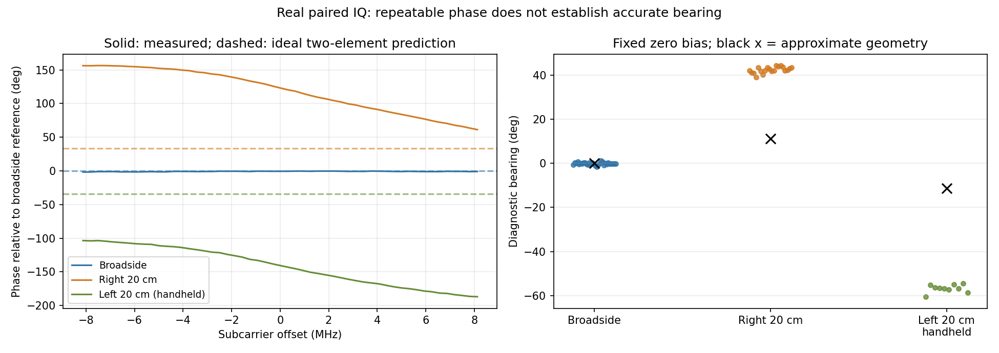

# 单站 DOA：ESP32 正前方参考、接收削顶修正与候选零点

**后续屏幕对照：** [第一轮开大屏幕 A/B/A](h29_record.md) 回程质量不足；[第二轮约30°开角 A/B/A](h30_record.md) 提供了屏幕状态与接收响应相关的支持证据，但回程波动较大，尚未确认唯一根因。原有非零来向角验收未通过的结论不变。

## 一、继续执行的提示词

先读 [单站 DOA 全信道改进](h27_record.md)，再从本文件结果继续。工程主线仍然是当前信道内的未知信号监测和单站测向，单站验收后才进入双站；**本次指定 ESP32 采样只用于已知信源标定，不能变成全系统的 MAC 白名单。**

用户已按要求摆好参考源：EXD30 暂时关闭，ESP32-S3 位于两天线中点正前方，天线竖直平行、间距 5.9 cm。此前要求距离约 1～2 m，用户确认“已放好”，但未另报精确距离及左右天线对应 RX 口；不要把未知的安装误差或角度正负方向写成已验证。

当前应优先：

1. 保留已经核验的真实 IQ、PCAP、帧索引和硬件 TSF，不重做内核/FPGA/SD 部署。
2. 参考采样固定两路 MGC 0 dB；近距离 MGC 20 dB 在本次 ESP32 条件下已经明显饱和，不能用于标定。0 dB 是接收增益设置，不是关闭接收。
3. **当前静止布置的候选偏置为 −67.1111°相位，早期 90.2658°候选已经被跨批次测试否定，不可复用。** 使用候选时必须匹配 2437 MHz、5.9 cm、双路手动 0 dB、线缆及现场布局；不能用于恢复后的自动增益模式。详见第八节。
4. **后续右移 20 cm 的非零角度测试已失败：几何参考约 11.3°，当前算法输出约 42°。** 零点稳定不能代替测角正确；当前候选不得用于正式来向或双站定位，不能改比例强行拟合。详见第九节。
5. 后续先复核现场静止条件下的跨批次零点，再测左右独立已知角度。相干多径、接收通道变化或现场运动尚未排除，不要通过扩大门限、只挑好看的样本或平滑曲线隐藏问题。
6. 已增加真实样本饱和识别：AD9361 12 bit 左对齐到 int16 后，正向满量程为 **32752**，负向为 **−32768**，不能只按 32767 检查正向削顶。
7. 正式全信道测向继续保留未知信号。仅在有已验证标定及合适质量条件时报告角度；不同突发分别处理，信号段数不是无人机数量。

## 二、真实参考源核验

- 开始时真实 `sdr0` 为 monitor，信道 6、2437 MHz、20 MHz 宽度；两路接收为 fast_attack。
- 通过已有 monitor HTTP 服务连续查询，约 3 秒内 ESP32 的有效 RID 包计数从 599 增至 602，最新包年龄约 0.10 s，确认不是旧记录。
- 参考源完整 MAC：`mac_aa98f353b5`；解码 Basic ID：`RIDTEST-ESP32S3-0001`；已知参考 PHY 为 6 Mbps OFDM。
- side_ch 触发 25 在 source-address 有效时触发，硬件只比较源 MAC 的后 4 字节；本次 reg7=`0xb1ce2708`，reg1=`0x4001`，reg11=1536，reg8=25。因为硬件不是完整 48 bit 匹配，**后续仍逐窗核对完整 MAC、RID 内容和有效 FCS**。
- IQ 窗口 TSF 与同一参考帧的 monitor TSF 相差 **53 μs**。monitor TSF 由有效 PHY SIGNAL 头锁存，IQ TSF 由 addr2 有效事件锁存，两者是同一 PL 硬件时基的不同事件，不能要求本模式下时间戳相等。
- 严格分析入口以显式 `--expected-trigger-delay-us 53` 和 ±1 μs 门限进行唯一匹配；缺失或匹配不唯一就拒绝关联。53 μs 是本次 FPGA/PHY 配置的实测值，不是所有波形通用常数。

## 三、发现并修正近距离接收削顶

### 1. 双路 MGC 20 dB 试验

采到 20 个真实窗口、20 个不同 TSF、无 DMA/netlink 错误，但结果不适合标定：

- RX1/RX2 整窗 RMS 约 2.27 万/2.65 万，已经很高。
- 样本在负向 −32768、正向 32752 频繁堆积，符合 AD9361 ADC 饱和码。
- 初始旧判据只识别到约 11%～14% 的样本触及负向满量程；修正正向 12 bit 满量程后，任一分量触及两端饱和的样本占比约 **19.85%～21.22%**，中位数 **20.29%**。
- 即使整窗相关度约 **0.969**，也不能证明波形未失真；高相关的双路削顶信号仍可能产生错误相位。
- 20 个触发窗口中仅 4 个能对应到同时通过完整 RID/FCS 的参考帧；这 4 个的硬件触发延迟均为 53 μs。
- 这些窗口全部被质量门控拒绝用于标定，未强行拟合偏置。

这说明“接收乱”至少包含一个已取得直接证据的问题：近距离参考源下的过大接收增益导致 ADC 削顶。不能据此宣称历史所有异常都由同一个原因造成。

### 2. 改为双路 MGC 0 dB

保持频率、采样配置、天线和信源位置，临时将两路增益固定为 0 dB，再采 20 窗：

- **20/20** 窗均可唯一对应完整 MAC、RID 和有效 FCS 的参考帧，触发延迟全部为 **53 μs**。
- 饱和样本比例全部为 **0**。
- RX1/RX2 整窗 RMS 大致为 1600～2800 / 3500～5300。
- 整窗相关度约 **0.976～0.997**；每窗均获得连续的相干信号段。
- 单包内相位离散度约 **0.24°～0.67°**，但包间仍存在较明显跳动。

两组属于顺序采集的现场实验；改善与降低增益、消除削顶一致，但未将它写成经过完整随机对照验证的全场景因果结论。

## 四、早期候选零点与留出重复性（后续跨批次失败，已停用）

按预定顺序，用低增益组前 10 个合格且身份已核验的包训练，用后 10 个包检查同一摆位的重复性，后 10 包不参与偏置拟合。

| 项目 | 实测结果 |
|---|---:|
| 参考角度 | 用户摆放的近似正前方 0° |
| 候选相位偏置 | 90.265793° |
| 训练包数 / 一致包数 | 10 / 10 |
| 训练包间相位离散度 | 1.648287° |
| 留出包数 | 10 |
| 留出包相对约 0°的平均绝对偏离 | 2.527239° |
| 留出包最大绝对偏离 | 5.917216° |
| 左右非零已知角度验证 | 未完成 |

如果将约 90°的当前参考相位直接当作纯空间相位，在 5.9 cm 间距下会把正前方信源解释为约 31°。这说明“馈线看起来等长”不能代替端到端相位标定。

**这里的偏置是当前整条接收配置及现场参考条件下的经验量，并未证明它全部来自内部走线或 RF 芯片，也未排除参考位置的多径影响。** 同位置留出测试是零点重复性，不是全角域测向准确度。

该早期候选当时记录为：

```text
status = provisional_known_angle_reference_only
independent_nonzero_angles_validated = false
accepted_for_production_bearing = false
```

尚未将该偏置自动注入全信道实时测向，避免对未知信号产生未经验证的正式角度。

## 五、OFDM 训练段检查

在 20 个未削顶、已核验参考窗口中，对前部 IQ 检查 64 点重复与 16 点重复，找到符合 OFDM 长训练段特征的连续片段。64 点重复相关度约 0.9992～0.9998，16 点重复相关度约 0.04。

这些片段的空间相位与整窗估计接近；后几个包的相位变化仍存在。**目前没有证据表明只换成训练段估计就能消除包间跳动，因此没有为改善图形而替换已工作的主算法。** 该检查属于诊断探针，尚未作为经过完整已知序列匹配验收的通用 LTF 检测器交付。

剩余可能因素包括现场运动、多径和通道响应变化；本轮不在证据不足时指定唯一根因。

## 六、代码与验证

- `linux_doa/reference_capture.py`：有界的已知参考源采集；仅临时改变 side_ch 触发和两路增益，结束时恢复；配置完成后复位采集 FIFO，避免混入切换前残留窗口。
- `linux_doa/reference_analysis.py`：完整 MAC/RID/FCS 校验、含扩展位图的 radiotap TSFT 解析、唯一硬件时间匹配、训练/留出划分及候选参考输出。
- `linux_doa/single_station.py`：修正 AD9361 左对齐 12 bit 的正向饱和码判断。
- 新增回归覆盖“仅正向 32752 削顶、双路相关度仍高”的错误输入必须被拒绝；来源关联覆盖缺失 TSFT、错时和重复匹配等情况。
- **15 项单元测试通过**。永久分析入口在实际低增益组输出 20 窗合格及候选偏置，在实际高增益组输出 0 窗合格并拒绝标定。

## 七、原始证据与继续操作

目录：`tmp/doa_cal_20261031_2307/`。

- `reference_state_probe.json`：实验前真实新鲜 RID 包查询。
- `board_evidence/esp32_boresight_20261031_2310/`：20 dB 组原始 IQ、TSF、SHA256、触发配置和实际增益。
- `board_evidence/esp32_boresight_mgc0_20261031_2312/`：0 dB 组原始 IQ 与元数据。
- `monitor.pcap`：真实 OpenWiFi monitor 抓包，包含对应的完整参考帧。
- `verified_mgc0/`：严格关联、逐窗诊断、候选零点及留出检查。
- `rejected_mgc20/`：削顶组被拒绝用于标定的证据。
- `ltf_probe.json`：训练段重复特征诊断。

下一步需要用户配合的物理条件：先让两天线、ESP32、邻近人员/手机位置稳定约 30 s，复核跨批次零点。随后保留接收天线不动，将同一信源放到可测量的左右方向。可先用固定前向距离 D、横向位移 `D × tan(20°) ≈ 0.364D` 构造约 20°参考，不能只凭目测或把移动距离直接当角度。

左右 RX 物理对应仍需确认，防止仅符号相反被误认为定位正确。双天线前后镜像和未知仰角限制仍存在。

本轮没有重编 FPGA/内核、覆盖 SD、修改 ESP32 固件或读取标签串口数据；测量来自 AD9361 双天线 IQ。每次实验结束均恢复两路 fast_attack，未把候选偏置套用到该自动增益状态。

## 八、按现有电脑布置继续验证后的修正结论

用户说明电脑因开发板连线与 ESP32 USB 供电限制，无法移到 1 m 以外；除电脑外其他物体/人员已尽量移开。实际条件为信源正前方约 1 m，电脑在斜侧方。本轮接受这一约束，**没有要求搬电脑、改变供电或新增硬件**。

### 1. 旧候选跨批次失败，不能继续沿用

复采 25 个未削顶、完整 RID/FCS/TSF 均核验的窗口，直接使用旧偏置 90.2658°，不重新拟合，得到相对正前方平均绝对偏离约 **59.11°**、最大约 **67.81°**。

因此旧偏置没有通过跨批次检验。不能只展示早期 2.53°的同批留出结果而隐藏这次失败，也不能先重新归零再声称旧标定重复性良好。

这一阶段前 4 包相位仍大幅变化，后续约稳定在 −67°附近。现场条件发生过整理，但尚不能把全部差异唯一归因于电脑、多径、人员或 AD9361 增益状态。

### 2. 三段连续对照

在用户确认的当前布置中采三段，每段 10 包；A/B 之间保持手动 0 dB，C 在一次恢复自动增益、随后重入手动 0 dB 后采集。三段均完成完整参考核验，零削顶：

| 段 | 接收状态 | 相位圆周均值 | 包间相位圆周标准差 | 片段相关度中位数 |
|---|---|---:|---:|---:|
| A | 固定 MGC0 | −67.1111° | 1.1224° | 0.8458 |
| B | 继续保持同一 MGC0 | −68.0647° | 2.3445° | 0.8522 |
| C | 自动增益后重新进入 MGC0 | −67.3013° | 1.0731° | 0.8546 |

该对照中没有出现早期那种约 150°的跨批次相位变化，**不支持把先前异常简单归因为“每次增益模式切换必然随机重置相位”**。也不能仅凭此试验永久排除其他状态变化。

### 3. 当前参考只用 A 训练，以 B/C 留出检验

保留原始文件不变，按 A、B、C 顺序组成可追溯数据集，用 A 的 10 包求当前候选 −67.1111°；B/C 共 20 包不参与拟合，直接应用该候选：

- 30/30 包均通过完整参考核验与质量门控。
- B/C 的同位置平均绝对偏离约 **0.4652°**，最大约 **1.6522°**。
- 这些是**当前桌面布置下的零点重复性**；参考位置仅为用户近似摆放，尚不能写成 0.47°绝对测角精度。
- 该候选仍标记 `accepted_for_production_bearing=false`，等待左右已知方向验证。

新增证据：

- `repeat_frozen_reference/`：旧偏置跨批次失败，偏置未重新拟合。
- `phase_session_summary.json`：A/B/C 对照统计及各包相位。
- `board_evidence/esp32_phase_session_20261031_2320_*/`：三段真实原始 IQ 与实际配置。
- `current_static_reference_raw/`：三段原样复制及逐文件来源、SHA256。
- `current_static_reference/`：当前候选及未参与拟合的 B/C 重复性结果。
- `old_reference_assessment.json`：旧候选不能用于当前布置的明确标记。

下一步已请求用户只把 ESP32 向一侧平移约 20 cm、前向距离保持约 1 m，电脑与接收天线不动，用约 11.3°检查响应。若只能平移 10 cm，则约为 5.71°，须按用户实际位移记录，不得默认已经移动完成。

## 九、首个非零方向检验：右移 20 cm，未通过

用户明确确认“已向右平移 20 厘米”，前向距离按当前约 1 m 记录，几何参考约 `atan(0.2/1)=11.3099°`；实际位置为人工近似摆放，不能当作精密角台真值。

保持当前偏置 **−67.1111°**、5.9 cm 间距和双路手动 0 dB，不重新拟合偏置或比例，采 20 窗：

- 20/20 完整 MAC、RID、FCS 与 53 μs TSF 对应核验通过。
- 20/20 质量合格，无削顶。
- 原始相位约 41.73°～53.63°，相对零点发生了明显变化。
- 当前相位干涉公式的诊断角约 **39.08°～44.37°**，相对约 11.31°的平均绝对偏离 **31.12°**。
- **该结果不通过。不能因为曲线稳定，就把约 42°视为真实来向，也不能把人工位移误差当作足够解释。**

这次数据证明当前“单一零点偏置 + 理想两阵元相位模型”尚未在现场有效。仍需分辨接收通路对应、安装/相位中心、多径及现场响应的影响；仅凭本轮数据不能指定唯一根因。

没有把有效基线改成某个拟合值、没有用 11.3/42 的比例缩放，也没有在右侧重新归零。

板端软件射频输入回读两路均为 `A_BALANCED`。用户已被请求提供两个天线接口的实际丝印，不要求拔线；物理对应尚待核对。另已请求以原零点为参照放到左侧 20 cm，或在空间不允许时回到正前方，用户实际回复前不得开始对应位置采样或写成已完成。

证据：`board_evidence/esp32_right20cm_mgc0_20261031_2324/` 与 `right20_frozen_reference/`。本轮单元测试现为 **16 项通过**，它们只证明程序相关边界行为，不能代替上述真实非零角度检验。

## 十、左侧快速对照、频域诊断与最终阶段结论

### 1. 用户实际约束与接口确认

用户确认天线实际接在标有 **RX1、RX2** 的接口。软件端两路输入均回读为 A_BALANCED；这排除了本轮明显接到 TX 接口的猜测，但还不能据此证明所有内部射频响应均已标定。

用户将 ESP32 放到原零点左侧约 20 cm，但该点悬空，只能手持并有轻微晃动。记录了人体靠近与手持条件，只采约 10 s，取得 10 窗后立即告知可以放下。**没有要求继续举着信源，也没有要求移动电脑。**

10/10 窗完成完整参考核验、无削顶，但同一固定偏置下诊断角约 **−60.50°～−54.37°**，与约 −11.31°的摆位不符。该位置并非精密角台真值，计算出的约 45.42°平均偏离仅用于描述本次模型失配，不作为精密误差指标。

现有数据表现为左右移动有相位响应，但角度幅度严重不符，**不能仅靠正负号翻转修正，也不能仅以曲线平滑判为成功**。

### 2. 同包子载波相位诊断

复用工程已有 NumPy/Matplotlib，未安装新环境。在已核验的参考窗口里利用重复训练段估计双通道频率响应，使用 A 段前 10 包的各子载波相位作为零点参考，非零位置未参与该参考拟合。



右、左两组相对零点的相位曲线随子载波频率明显变化，与理想 5.9 cm 单径预测相差较大。线性斜率对应的**有效相对群时延诊断量**约为 −18.05 ns / −16.28 ns；5.9 cm 纯几何阵元时差上限约为 0.197 ns。

这些拟合量混合了通道响应、传播及估计误差，**不能直接当作目标 TDOA 或换算无人机距离**。它们支持“当前数据不满足简单单径/单一标量偏置模型”，尚不能唯一证明电脑、多径、耦合、跟踪状态或其他某个因素是根因。重复段相关度高也不等于绝对来向正确。

官方资料也未承诺 RX1/RX2 的相对相位天然固定，强调需要在相应频率和增益条件下实测；共同信源经功分器送入两个 RX 可帮助分离接收链响应与外部传播影响。参考 [ADI 关于 RX1/RX2 相位的答复](https://ez.analog.com/rf/wide-band-rf-transceivers/design-support/f/q-a/79276/ad9361-phase-offset-between-rx1-and-rx2)、[ADI 共同信源/功分器对照讨论](https://ez.analog.com/rf/wide-band-rf-transceivers/design-support/f/q-a/596142/phase-diff)。这些资料用于设计后续对照，不能替代本机根因证据。

### 3. 下一步按已有器材选择，不要求搬电脑

1. 若已有/可借二路射频功分器和合适的受控参考源，优先做双路共源接收链校准，区分 RF 链响应与空间传播；需先核对连接和输入电平，不能随意将板上 TX 直接接入 RX。
2. 若没有功分器而已有充电宝/电池，可先让 ESP32 独立供电做受控对照，检验电脑 USB 供电/线缆布局变化的影响；供电改变可能导致 ESP32 重启，须重新确认广播，不能把开机前后的数据混为一个连续状态。
3. 用现有非金属支撑固定参考源，避免手持角度测试；保持电脑、天线、线缆及支撑位置可重复，不需要将电脑搬到 1 m 之外。
4. 只有受控接收链及独立方向测试通过后，再评估多子载波一致性门控、实测阵列流形或稳健拟合的改进。不要用已知左右点拟合比例后，再用同样的点宣称精度通过。

已请求用户仅说明现有充电宝/电池或功分器条件，暂不要求改接线；收到回复前不把器材写成已具备，也不开展依赖它的试验。

### 4. 保存与当前状态

- 本轮共保留 **125 个不重复实测 IQ 窗口**，未把 A/B/C 离线组合副本再次计数。
- 其中 109 窗通过完整参考身份、FCS 与时间匹配；高增益组另 16 窗未通过完整来源核验，20 个高增益削顶窗均未用于标定。
- 永久判定与原始文件 SHA256 清单：`linux_doa/validation/20261031_2307/`。
- `assessment.json` 明确为 `nonzero_angle_validation_failed`，正式测向与双站定位均不接受此候选，未激活运行时标定。
- 原始 125 窗、有效 monitor PCAP、逐窗核验及诊断图仍位于 `tmp/doa_cal_20261031_2307/`，报告图另保存于 `提示词/附件/`。
- 接收削顶判据修正和参考采集辅助脚本已同步板端。后续继续使用已有接收链，不需重新复制 SD、重编内核/FPGA或安装 ESP32 SDK。

## 十一、用户补充：电脑位于约 40°～50°方向

用户观察电脑相对接收天线约位于 40°～50°，接近右侧试验的约 42°诊断值，提出电脑干扰假设。已作为后续受控对照线索记录，**没有据此确认电脑就是根因**。当前诊断角本身未通过几何验收，也不能直接用它定位干扰源。

已核验的帧内容匹配预期 ESP32 MAC/RID，但这不能证明该包只经直达路径到达。电脑可能作为反射/散射体，也可能有无线发射、USB 连接或其他电磁耦合影响；这些机制需要分别测试。反射路径可具有不同到达方向，参考 [MathWorks 两径传播说明](https://www.mathworks.com/help/phased/ug/two-ray-multipath-propagation.html)。

不搬电脑时可安排以下对照，每项都先固定 ESP32、两根天线和线缆，保存独立 IQ；不能同时改变多个条件：

1. ESP32 由电脑 USB 改为确认过的 5V 独立 USB 电源，只用于检验供电/线缆路径。电脑仍在原处，因此该对照不能单独排除被动反射。
2. 若不影响当前联网，另做电脑 Wi-Fi/蓝牙开关对照，用于检验部分无线发射影响；不自动修改主机网络设置，且无线电关闭也不能消除电脑的反射。
3. 电脑底座不动，仅改变屏幕开合角度，按 A/B/A 顺序采集，检查预期 ESP32 包的相位是否随屏幕状态可重复变化。该结果可检验电脑状态的影响，但不能只凭一次变化就唯一归因于反射。

目前未开展上述新对照，也没有关闭用户电脑无线网络；现有结论仍为非零角度验收未通过。
