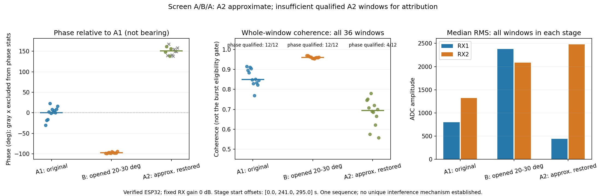

# 电脑屏幕角度 A/B/A 对照：执行协议与实测记录

## 一、目的与边界

用户观察电脑位于天线约 40°～50°方向，与此前错误诊断角约 42°接近，提出电脑影响假设。本轮在不搬电脑的条件下，检验**屏幕状态改变是否伴随可重复的双通道相位变化**。

本轮不重新标定零点、不拟合角度比例，也不将相位变化换算成经过验证的真实来向。即使观察到关联，也不能仅凭一次 A/B/A 唯一判定为屏幕反射、Wi-Fi 发射、USB 电磁耦合或某种其他机制。

前序依据见 [单站零点与非零方向检验](h28_record.md)。其中非零角度检验尚未通过，结论保持不变。

## 二、对照流程与固定条件

用户确认 ESP32 已固定，不再手持；屏幕先保持当前角度。本轮不要求重新摆到正前方，只要求整个对照中信源、两根接收天线、电脑底座、线缆和供电保持不动、不变。

1. A1：屏幕原角度，采 12 个参考 IQ 窗口。
2. B：用户只改变屏幕开合角度，目标为明显开大或收小约 20°～30°，保持开机、不合盖、不休眠；具体变化按用户回复记录，确认后静置 3 s 再采 12 窗。
3. A2：用户恢复原屏幕角度，确认后静置 3 s，再采 12 窗。

屏幕原始角度及实际变化不是精密角台读数。人员、后台负载与其他环境变化无法完全控制，结论限于本次条件下的关联与重复性。

接收条件：2437 MHz、双路手动 0 dB、IQ 20 MSPS、每窗 4096 组双通道样本，天线间距沿用用户确认的 5.9 cm。

**三段共用一个固定增益上下文，段间不恢复 AGC、不重新设置 RF 增益、LO 或 FIR。** 段间仅清理 side_ch 采集 FIFO。实验正常完成、超时或可处理的中断后恢复原有增益模式和 side_ch 配置。

实验同时使用独立的 AF_PACKET 接收套接字保存本轮 monitor PCAP；已有 OpenWiFi monitor/RID 服务保留。后续按完整 MAC、预期 RID、有效 FCS 和唯一硬件时戳对应核验 IQ 来源，不能只依赖硬件四字节 MAC 匹配。

## 三、在看到对照结果前固定的分析口径

- 每段至少 8 个来源已核验、单一连续合格信号段、无削顶的窗口，才进行相位对照；不足时判为数据不足，不判为“没有影响”。
- 相位均值和标准差使用圆周统计，差值在 ±180°内处理，避免跨界误报。
- 原状态返回门限：`max(5°相位, 2×sqrt(σA1²+σA2²))`。
- B 状态差异门限：`max(5°相位, 2×max(σA1,σB,σA2))`，B 必须相对两个 A 都超过门限。
- A2 未恢复到 A1 的范围时，判为不能归因的未复现对照；不强行判电脑有影响。
- 这些是本次探索性的工程门限，**不是显著性检验，也不是测角精度指标**。
- 任何采集异常、RF 未恢复、PCAP 超限或 monitor 错误，都保留并使对照判定为未完成/完整性失败。

## 四、实现与初始状态

- 板端 `linux_doa/screen_aba.py`：有界 A/B/A 会话、单一固定增益上下文、阶段请求文件、原始 IQ 和独立 PCAP、原配置恢复。
- PC 端 `linux_doa/screen_aba_analysis.py`：参考帧核验、质量筛选、圆周统计及探索性对照判定。
- 新增 4 项分析测试通过，覆盖跨 ±180°、B 改变且 A 返回、A 未返回和数据不足等情况。
- 板端初始状态已确认：当前 OpenWiFi 内核、sdr0 monitor 信道 6、side_ch 已加载，两路初始均为 fast_attack。
- Windows 无线状态查询返回权限错误，本轮没有修改位置权限、关闭 Wi-Fi/蓝牙或更改主机网络设置。

板端目录：`/root/doa_stage/screen_aba_20261031_2351/`。

## 五、阶段记录（执行中更新）

A1/B/A2 均完成采集，每段 12 窗，共 36 个不同硬件 TSF。用户对 B 的确认是“屏幕已开大约20～30°，其余不动”；对 A2 的确认是“只能大致恢复，存在一些角度误差”。该恢复误差已保留到阶段元数据和分析结果。

独立 monitor PCAP 记录 8487 个包；36/36 个 IQ 窗口均通过完整 ESP32 MAC、RID、FCS 和 53 μs 硬件时戳对应核验。无采集错误、无削顶、PCAP 未超限。结束后两路原有 fast_attack 均恢复。

## 六、实测结果与判定

| 阶段 | 实测窗口 / 来源核验 | 相位比较合格 | 合格窗相位均值 | 包间相位标准差 | 全部窗口相关度中位数 |
|---|---:|---:|---:|---:|---:|
| A1 原角度 | 12 / 12 | 12 | −101.500° | 14.461° | 0.849 |
| B 屏幕开大约20～30° | 12 / 12 | 12 | 160.986° | 1.473° | 0.961 |
| A2 大致恢复 | 12 / 12 | 4 | 49.648° | 8.938° | 0.694 |

表中的角度单位均为**相位度数，不是来向角**。B 相对 A1 的圆周相位差约为 −97.51°，不能按普通减法误报为约 262.49°。

A2 有 8 个窗口因为没有持续合格片段或分成多个片段而未用于单一相位比较，并非没有收到参考包。全部窗口的 RX1/RX2 RMS 中位数为：A1 799/1319，B 2376/2087，A2 437/2482；说明接收状态和两路幅度平衡也发生变化。

预先固定的最少合格窗数为每段 8 窗，A2 仅 4 窗，因此本轮判定为 **`insufficient_qualified_windows`**，不临时降低门限使试验“通过”。A2 也未回到 A1 附近，而且用户明确说明只大致恢复屏幕角度。

可以确认：本次调节屏幕期间，已核验的 ESP32 信号接收状态变化明显，B 组在本次采样中更稳定。**尚不能确认电脑是此前测角错误的根因，也不能据此排除电脑影响或唯一认定为屏幕反射。**

此外，三组首个样本相对 A1 的时间偏移为 0、241、295 s，存在等待用户操作的时间间隔。单次序列、时间变化、恢复角度误差与人员/后台状态等均限制因果归因。

## 七、交付与后续

- 永久原始证据、独立 PCAP、SHA256 清单、分析及代码快照：`linux_doa/validation/screen_aba_20261031_2351/`。
- 临时工作目录：`tmp/screen_aba_20261031_2351/`。
- 全部 20 项相关单元测试通过；这些测试不等于本轮物理假设被确认。
- 本轮没有启用任何来向标定、没有拟合角度比例，原单站非零角度未通过的结论不变。

用户随后提出将屏幕收小到仅留可观看的小角度，进行另一轮对照。该后续将另建独立实验，不覆盖本次 A/B/A 数据；先采当时的当前屏幕角度，再采小开角，最后回到该新实验起始状态。电脑底座、ESP32、天线、线缆和供电继续保持不变。

本报告实验开始于 2026-10-31 23:51 前后，结果整理跨至 2026-11-01；文件名保留本轮开始日期与时间。
