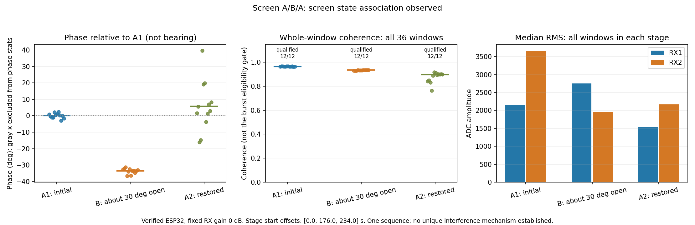

# 屏幕近合 A/B/A 对照：第二轮执行协议与结果

## 一、背景与目标

用户在第一轮开大屏幕试验后，提出将屏幕尽量收小、仅保留可以观看和操作的开角，再测一次。第一轮结果见 [电脑屏幕角度 A/B/A 对照](h29_record.md)：B 组更稳定，但 A2 仅 4/12 窗满足相位比较条件，且用户只能大致恢复，因此未形成完整可重复归因。

第二轮独立保存，不覆盖第一轮数据；比较的是屏幕状态与已核验 ESP32 信号接收状态的关系，不进行角度标定或精度宣称。

## 二、第二轮控制条件

- A1：本轮开始时的当前屏幕角度，先采 12 窗。
- B：用户收小屏幕至仍可看清、可操作的小开角，保持屏幕点亮、电脑不休眠；具体状态以用户实际确认为准，不预填实际开角。
- A2：恢复到本轮收小之前的角度，再采 12 窗；记录是否只能大致恢复。
- ESP32 固定不手持，电脑底座、天线、线缆、供电保持不变；本轮不要求移动电脑或改为充电宝供电。
- 三段共享一个双路 MGC0 会话，段间不改变 RF 增益、LO、FIR，确认操作后静置 3 s 再采对应阶段。
- 每段目标 12 窗；每段等待用户确认最多 300 s，实验正常结束、超时或可处理的中断后恢复原配置。
- 各段全部原始 IQ、独立 monitor PCAP、时间戳和配置均保留，按完整 MAC/RID/FCS/53 μs 硬件对应关系核验。

判定门限沿用第一轮、不会因结果不好而降低：每段至少 8 个来源核验且相位质量合格的窗口，再检查 B 差异与 A 返回。对全部窗口的相关度、RMS 和相位作描述性记录，**不使用这些描述性相位绕过原有门控**。恢复角度误差、时间间隔和其他未充分控制因素仍限制因果归因。

## 三、实现与数据目录

复用 `linux_doa/screen_aba.py`，采用新的实验目录 `/root/doa_stage/screen_nearclosed_20261101_0003/`，首轮数据不变。PC 端复用 `screen_aba_analysis.py` 并补充全部窗口描述性相位；该补充不改变原来的比较门限。

## 四、阶段记录（执行中更新）

A1 已采得 12 个窗口、12 个不同 TSF，未报告采集错误。

用户对 B 的实际确认：只能保持约 **30°开角**，更小会黑屏/熄灭。本轮接受这一可行条件，不要求进一步合屏，不修改合盖/休眠设置；B 按“约30°开角、屏幕保持点亮”采样。该 30°是用户估计的屏幕开角，不是来向角或精密角台读数。

B 请求已在收到上述确认后发出。B 完成后，用户明确回复“已恢复到本轮起始角度”，再开始 A2，未将第一轮的“大致恢复”状态沿用到第二轮。

## 五、完整实测结果

三组各取得 12 窗，共 36 窗；**36/36 完成完整 MAC、RID、FCS 和 53 μs 硬件对应核验，36/36 满足预定相位比较条件，均无削顶**。独立 monitor PCAP 记录 3337 个包，未超限、无接收线程错误。三段期间保持同一个手动 0 dB 会话，结束后原有双路 fast_attack 已恢复。

| 阶段 | 合格 / 来源核验窗口 | 相位圆周均值 | 包间相位圆周标准差 | 全窗相关度中位数 | RX1 / RX2 全窗RMS中位数 |
|---|---:|---:|---:|---:|---:|
| A1 本轮起始角度 | 12 / 12 | −146.922° | 1.459° | 0.964 | 2141 / 3662 |
| B 约30°开角 | 12 / 12 | 179.479° | 1.531° | 0.934 | 2753 / 1960 |
| A2 用户确认恢复起始角度 | 12 / 12 | −141.125° | 14.606° | 0.896 | 1534 / 2172 |

**表中的度数是接收通道相位，不是目标来向角；用户估计的30°则是电脑屏幕开角，两者含义不同。**

圆周相位差为：

- B − A1：约 **−33.600°**。
- B − A2：约 **−39.396°**。
- A2 − A1：约 **+5.797°**。

B 接近 +180°边界，已使用圆周差值，不把普通减法所得约 326.4°当作真实变化。

按此前固定的探索性工程口径，本轮输出 **`screen_state_association_observed`**：B 相对两个 A 的差异均超过约 29.21°门限，A 的返回均值差小于约 29.36°门限。

这些门限包含组内波动，A2 的 14.61°标准差使返回容差较宽；本轮不是严格显著性检验，**不能把“通过探索性门限”写成高置信度的唯一因果证明**。虽然 A2 均值较接近 A1，恢复后的波动明显增大，仍应保留这一限制。

## 六、与第一轮合看后的结论

1. 第一轮的 B 组更稳定，但 A2 质量不足且只大致恢复，不能作完整归因。
2. 第二轮所有窗口合格，屏幕收小后相位与双路幅度发生变化，恢复后均值向基线返回。这提供了**屏幕状态与当前接收响应有关的支持证据**。
3. 尚不能区分被动反射/遮挡、电脑无线天线方向、其他电磁耦合、人员/时间变化等机制，也不能证明电脑是之前测角错误的唯一根因。
4. **原有单站非零角度验证未通过的结论不变。** 本轮没有校准来向角、没有拟合比例、没有启用正式测向或双站定位。
5. 两轮独立启动，起始屏幕状态、时刻及 RF 会话不同；只能各自作内部对照，不应直接拼接两轮绝对相位去计算一个共同零点。

本轮三段首个样本相对 A1 的时间偏移为 0、176、234 s，存在操作等待间隔。仅一次 A/B/A，加上人工屏幕角度和未完全控制的环境因素，限制结论的因果强度。

## 七、交付、验证与后续主线

- 原始 IQ、独立 PCAP、元数据、SHA256 清单、分析、图和代码快照：`linux_doa/validation/screen_nearclosed_20261101_0003/`。
- 临时工作目录：`tmp/screen_nearclosed_20261101_0003/`。
- 两轮共保留 72 个真实 IQ 窗口，全部完成来源核验；相位比较合格数第一轮28、第二轮36，不混淆接收成功与测角有效。
- 相关 20 项单元测试通过，覆盖相位跨界、缺样本、A未返回和接收配置错用等边界；不作为硬件精度证明。
- 两轮均已恢复原有双路自动增益与 side_ch 配置，COM9 每次操作后释放；未关闭电脑 Wi-Fi/蓝牙、未修改休眠设置。

结束后经 COM9 独立读回复核：两路增益模式均为 `fast_attack`；side_ch 寄存器 1=1、7=0、8=0，地址匹配触发已关闭，未留下实验参考源筛选。该复核读取完成并释放串口；板端记录为 `/root/doa_stage/screen_nearclosed_20261101_0003/restoration_check.json`。

后续可以先选一个能够正常操作、不会黑屏且容易固定的屏幕角度，并标记该角度。固定电脑、参考源支撑、天线及线缆布局，先验证跨批次稳定性，再在同一条件下重新做零点和独立左右已知角度验收。**改变屏幕、供电或布置后，不直接沿用旧相位偏置。**

若继续排查唯一根因，应另设独立供电或双路共源接收链对照，逐个改变条件；不同时改变屏幕和供电，也不以本轮屏幕关联替代 RF 接收链标定。

## 八、下一轮执行提示词

先读本文件和前序报告，保留现有接收链、原始证据和失败记录，不重做内核/FPGA/SD 部署。选择能够固定且便于用户操作的屏幕角度，记录参考源与接收天线布局。先复核跨批次稳定性，再开展独立左右已知角度检验；不要因本轮观察到关联而宣称测向精度已通过。

实验参考源筛选仅限有界对照，主线继续监测当前信道所有信号、保留未知信号。未经有效标定和独立角度验收，不启用正式来向或双站定位。若继续做供电或 RF 共源校准，先核对用户已有器材与实际接法，避免默认已经换用独立电源。

## 九、收工退出状态

用户要求关闭全部检测端口和后台、收起设备，留待白天继续。已关闭 Windows RID 地面站和 DOA 界面及其启动包装进程；复核相关 Python 进程无残留，18770、8896 等检测端口无监听。板端 RID monitor 服务已退出，18771 监听消失；无存活的屏幕实验采集或临时导出服务，`sdr0` 已关闭。

板端执行 `sync` 后正常关机，串口确认 `/boot` 卸载、到达 `Power-Off`，最终输出 `reboot: System halted`。串口助手已退出并释放 COM9。关机尾部另有 `spi-nor spi1.0: Erase Error occurred` 一行；本次未执行 SPI 擦写操作，保留该现象供下次启动时核对，不据此推断存储损坏。

截至本次收工，板端处于停机状态，下一次实验需重新上电、启动服务；关机前配置读回记录不代表服务仍在运行。原始数据、分析和报告均已保留。
