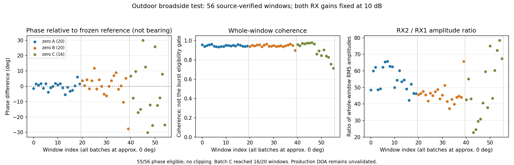

# 室外单站 DOA 零度复测

后续关键更新：用户发现换线前有一路天线侧疑似接触不良、近似断路。本报告中的异常数据保留作为排查证据，不能直接作为可靠连接状态的标定基线。换线后的实测及解释修订见 [双接收通道换线对照](h32_record.md)。

## 一、本轮布置与前序结论

2026-11-01，用户移至实验室窗外露台，报告网线、UART、平台相关线缆和接收天线均已接好，ESP32 持续发送 RID。电脑距接收天线约 2 m，ESP32 距天线约 1 m，位于电脑与天线之间，方向约为两天线中点正前方的 0°。距离与角度均为用户估计，没有测量布置公差。

先读 [近合屏幕对照报告](h30_record.md) 及现有 `linux_doa/SINGLE_STATION.md`。上一轮支持屏幕状态影响接收，但非零角度测向尚未通过。本轮不沿用昨晚相位偏置，不将露台等同于无多径环境。用户随后再次确认两天线竖直平行、中心间距 0.059 m，分别连接 RX1、RX2。

## 二、恢复接收链与空口结果

- 板端已重新启动，内核仍为 `5.15.0-175919-g427c94e8faa5-openwifi-rx1`，COM9 可读写，eth0 为千兆链路。
- 使用既有脚本恢复 OpenWiFi、monitor 和 RID 服务，补回板端临时 IPv4 地址 `169.254.92.202/16`，没有重写 SD、DTB、内核或 FPGA。
- monitor 在信道 6、HT20 接收；AD9361 RX LO 实际读回 2436999998 Hz，与目标频率相差 2 Hz，采样率 40 MSPS。沿用当前 PL 的双通道 IQ 20 MSPS 时基。
- 加载匹配内核的 `side_ch.packet.ko`，双通道、4096 点、硬件触发。
- 从 `/api/state` 实读到完整参考 MAC `mac_aa98f353b5`、RID `RIDTEST-ESP32S3-0001`，Wi-Fi Beacon、6 Mbps、2437 MHz，FCS 校验通过。数据来自天线—AD9361—OpenWiFi—monitor—RID—以太网链路，没有读取 ESP32 串口代替空口结果。
- 新收到的 Location 含经纬度、几何高度与广播时间字段；首读示例为纬度 34.1259118、经度 108.8310873、几何高度 389.0 m、水平速度 0 m/s。这是模块声明的数据，不是本平台独立测得的位置、高度或测向精度。direction 字段也不是接收站 DOA。原始快照另存于证据目录。

主服务继续接收所有 monitor 帧；临时参考 IQ 实验才使用 MAC 后四字节触发，分析仍要求完整 MAC、RID、FCS 和唯一硬件 TSF 对应。该筛选不作为正式全信道监测准入条件。

## 三、0 dB 诊断：双路幅度明显不平衡

原计划三批各 20 窗，三批之间保持同一个手动增益会话。第一批在 28 s 限时内只取得 14 个真实窗口，按原定数量要求中止，未降低门槛或伪称完成三批。中止后双路 `fast_attack` 及 side_ch 原配置已恢复。

| 指标 | 第一批结果 |
|---|---:|
| 实收 / 来源核验 / 相位质量合格窗口 | 14 / 11 / 11 |
| 削顶窗口 | 0 |
| 全窗相干度中位数 | 0.898 |
| RX1 / RX2 全窗 RMS 中位数 | 53.56 / 2136.93 |
| 合格窗口相位圆周均值 / 标准差 | −89.15° / 6.57° |

在读回的两路手动增益均为 0 dB 的条件下，RX1 幅度约为 RX2 的 1/40。不能直接据此判定某根线损坏，但应优先区分增益不足、射频接收通路或实际连接差异。当前不足以启用测向标定。

仅用前 10 个合格窗口产生的候选偏置约 −86.83°，训练内点 9/10、相位离散 4.70°；剩余只有 1 个零点留出窗口，诊断偏差约 3.59°。**样本不足且没有跨批次及非零角度验证，该候选不部署、不作为精度结论。**

首次预检因误用频率整数严格相等，拒绝了正常的 2 Hz LO 读回偏差；已改用既有工具一致的 ±10 Hz 容差，新建 `_r1` 目录采集，未覆盖原失败目录，也未为消除读回偏差反复调谐射频。

## 四、10 dB 固定增益对照

保持所有物理布置不变，两路临时固定到 10 dB，再尝试三批各 20 窗；不借增加增益掩盖削顶。射频读回确认两路均为手动 10 dB、两路输入均为 `A_BALANCED`、正交跟踪开启、采样率仍为 40 MSPS。

| 指标 | 零点 A | 零点 B | 零点 C |
|---|---:|---:|---:|
| 实收 / 来源核验 / 相位合格窗口 | 20 / 20 / 20 | 20 / 20 / 20 | 16 / 16 / 15 |
| 全窗削顶数 | 0 | 0 | 0 |
| 相位圆周均值 | −85.12° | −85.04° | −89.11° |
| 相位圆周标准差 | 2.48° | 8.09° | 17.95° |
| 全窗相干度中位数 | 0.943 | 0.947 | 0.924 |
| RX1 / RX2 全窗 RMS 中位数 | 132.50 / 7150.38 | 137.81 / 6445.39 | 133.31 / 6229.28 |
| 冻结零点参考后的诊断角平均绝对偏差 | 0.77° | 1.79° | 5.43° |
| 冻结零点参考后的诊断角最大绝对偏差 | 2.04° | 9.22° | 10.02° |

诊断参考仅取 A 的前 10 个合格窗口，偏置约 −85.017°；A 其余 10 窗与 B、C 均用该固定偏置计算，没有分别重新归零。表中角偏差仍是用户报告约零度条件下的诊断数值，不是独立非零角度精度验收。

第三批 28 s 内仅取得 16/20 窗，程序因此按限时规则中止，并恢复两路 `fast_attack` 和 side_ch 配置。共 56 个窗口全部核验为参考 RID，55 个满足相位比较条件，无削顶。独立 PCAP 有 114 个 monitor 帧，其中 65 个完整参考 RID 帧；这些数量不能直接当作空口检出率或丢包率。

增加至 10 dB 后，RX1 仍远弱于 RX2，两路全窗 RMS 中位数之比约 47～54；相位波动随批次增大。因此没有证据支持“搬到室外后问题已经解决”，也不应只挑第一批稳定数据宣布标定成功。幅度不等本身不等于角度必错，但与当前跨批次不稳定共同构成优先排查接收链的理由。

## 五、证据位置与后续提示词

0 dB 原始 IQ、独立 monitor PCAP、配置、分析、候选参考及 SHA256 清单：

`zynq7045_ad9361_rid_aoa/linux_doa/validation/outdoor_zero_20261101_1457_r1/`

10 dB 的同类完整证据及图：

`zynq7045_ad9361_rid_aoa/linux_doa/validation/outdoor_zero_gain10_20261101_r2/`

两次共保留 70 个原始 IQ 窗口，67 个完成完整来源核验，66 个满足本轮相位比较条件。未启用正式测向或双站定位，采样期间主 RID monitor 服务保持全信道接收。生产者结束记录确认临时参考触发恢复为寄存器 1=1、7=0、8=0、双路 `fast_attack`。

数据下载与分析完成后，再次联机检查出现新情况：COM9 可以打开，但两次命令均未收到完成标记；HTTP 18771 连接超时。因此最后的实时在线状态尚不能确认，不把生产者的正常恢复记录当作当前仍在线的证明。已询问用户是否在馈线互换时断电，等待确认后再恢复连接；没有据此重刷或重启硬件。

随后 Windows 网卡只读检查确认“以太网 4”为 `Disconnected`、0 bps，COM9 仍枚举。这支持优先核对平台供电/网线物理链路，尚不足以认定板端软件崩溃。

下一步已请求用户只互换开发板 RX1/RX2 的两根外部天线馈线，天线实体、线缆走向、ESP32 与电脑位置不变，记住原接法，等待用户确认后再采对照。**截至本条写入，尚未得到互换完成确认，不得把当前数据描述为已换线结果。** 互换后重点比较固定增益下的幅度差：弱路若随外部天线/馈线组合换到另一通道，支持继续排查该外部通路；若仍固定在原通道，则优先检查接收通道、端口选择及数字映射，但单次结果仍不能唯一定位损坏器件。

换线前后的相位不能直接拼接作测角精度验收，必要时先恢复原接法再重新建立参考。接收链质量改善后，再在冻结配置和偏置的条件下做独立零点批次，随后才做左右已知角度验收。保留本轮失败窗口；不给多信号窗口直接贴上多架无人机的标签。

## 六、用户断电说明与 Web 地面站恢复

用户随后确认“换线时已暂时断电”，前述断连有了明确的操作背景，不能作为软件崩溃证据；但“馈线已互换完成”仍未单独确认，尚未采换线后的对照 IQ。

按用户要求启动本地 Web 地面站，并用系统默认浏览器打开 `http://127.0.0.1:18770/`。后台进程为 Python，日志保存于 `tmp/ground_station_20261101.stdout.log` 与 `.stderr.log`。网页 HTTP 200；随后恢复板端既有 OpenWiFi/RID 服务，`/api/rid` 实测 `connected=true`、无连接错误，已显示 `RIDTEST-ESP32S3-0001`，来源为 `OpenWiFi OFDM / sdr0`，信道 6、6 Mbps、FCS 有效、位置状态为“RID广播当前位置”。因此地面站已连回真实空口数据，而非仅启动网页外壳。串口操作结束后已释放 COM9。
