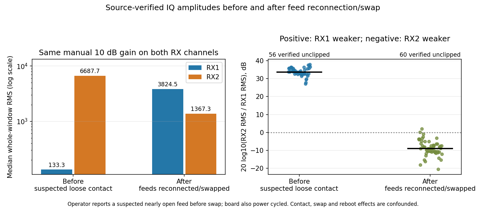
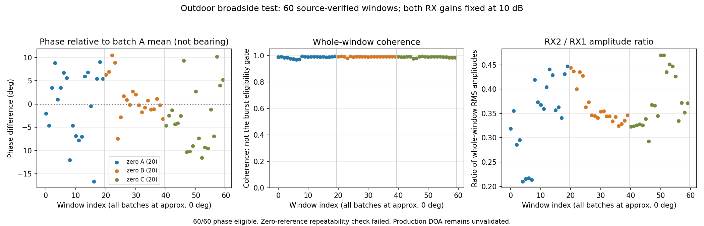

# 双接收通道换线对照

## 一、目的与操作背景

前序 [室外零度复测](h31_record.md) 中，用户确认双天线竖直平行、中心间距 5.9 cm，分别接 RX1/RX2；ESP32 位于约正前方 1 m，电脑约距天线 2 m。两路等增益 10 dB 时，RX1 全窗 IQ RMS 明显小于 RX2，三批数据中位数比约 47～54，同时相位跨批次不稳定。

用户确认换线时暂时断电，随后恢复 Web 地面站，再明确要求“现在做换线对照”。据此按换线后的接法采样，不重复要求确认；接法状态按用户操作和本轮要求记录，没有照片或独立硬件遥测证明接头位置。

本轮用于判断幅度弱路是否随外部天线/馈线换到另一接收通道，不用于重新归零、左右测角或正式 DOA 精度验收。外部通路包括天线、馈线、接头及天线所在空间传播路径；一次互换不能单独判定某条线或某器件损坏。

## 二、采集协议

- 复用原 OpenWiFi 接收链，信道 6、HT20、目标 2437 MHz、AD9361 40 MSPS、双通道 IQ 20 MSPS。
- 板端断电后重新加载匹配当前内核的 `side_ch.packet.ko`，不刷写 FPGA、内核、DTB 或 SD。
- 双路临时手动固定为 10 dB，三批之间保持同一个 RF 会话，无增益、LO、FIR 重配置。
- 每批静置 3 s、清采集 FIFO，目标 20 个窗口，最长 28 s；不足则如实中止并保留已有数据。
- 同时保存独立 monitor PCAP，按完整 MAC `mac_aa98f353b5`、RID `RIDTEST-ESP32S3-0001`、有效 FCS 和唯一 IQ/monitor TSF 差 53±1 µs 核验来源。
- 临时 IQ 参考触发只用于本轮有界对照，主 RID monitor/Web 地面站继续接收当前信道内所有可解码帧。正常结束或可处理异常后恢复原增益模式及 side_ch 设置。

换线前后频率、IQ 率、天线间距、手动增益和参考 MAC 均需一致；板端中间断电重启及 RF 重新初始化是已知混杂因素，因此不以两次绝对相位差作测角结论。

## 三、结果

三批均收满 20 窗，共 60 窗；60/60 完成完整 MAC/RID/FCS/硬件 TSF 核验，58/60 满足相位质量条件，均无削顶。独立 monitor PCAP 共 1711 帧，无接收线程错误、未触及文件上限，其中完整参考 RID 帧 69 个。其他 monitor 帧仍保留，不作为无人机数量。

| 指标 | 换线前参考 | 当前换线后 |
|---|---:|---:|
| 实收 / 来源核验 / 相位质量合格窗口 | 56 / 56 / 55 | 60 / 60 / 58 |
| 未削顶参考窗口 RX1 RMS 中位数 | 133.30 | 3824.49 |
| 未削顶参考窗口 RX2 RMS 中位数 | 6687.74 | 1367.28 |
| 逐窗 RX2/RX1 幅度比的中位数 | 47.54 | 0.358 |
| 同一幅度比的 dB 表示 | +33.54 dB | −8.92 dB |
| 参考窗口全窗相干度中位数 | 0.945 | 0.977 |

当前 RX1 比 RX2 强约 2.79 倍，两路已回到同一数量级，先前约 48 倍的极端差异明显改善。逐窗幅度比中位数与两路 RMS 中位数的比值不同，表中分别如实记录，不混用计算口径。

当前三批相位圆周均值约 −107.60°、−120.56°、−123.95°，各批圆周标准差约 25.61°、13.27°、19.69°。当前信号较强、相干度较高，仍不能等同于稳定来向；本轮没有生成或部署新相位偏置。

## 四、用户补充的关键事实与结论修订

分析过程中用户补充：“我发现换线前的时候，天线那边儿有一路没接好，近似于断路了，感觉。”随后明确确认“刚才是rx1”，并确认当前两路都已插牢拧紧。这是用户观察到的 RX1 外部连接问题，尚未用仪表确认电气开路。

因此本次不是只改变通道接法的严格互换试验：重新插接可能同时改变接触质量，加上中间断电重启，**不能将幅度弱路翻转直接归因于某条馈线损坏，也不能据此断言板端 RX1/RX2 损坏或正常**。此前纯数值规则给出的 `weak_path_moves_to_rx2_after_external_feed_swap` 仅保留作幅度变化的描述；最终状态改为 `comparison_confounded_by_operator_reported_suspected_bad_contact`，原始自动结果另存留痕。

现有数据支持优先处理外部接触问题：极端幅度不平衡与用户报告的疑似断续连接相符，重新插接后明显改善。但当前相位仍不稳定，不能认定故障已经完全排除。高相干度也不能独立证明两路天线连接正常。

用户已确认两路天线端、馈线端和 RX 接口插牢拧紧、手离开后保持不动，原松动一路为 RX1。已据此开始重新采集连接可靠状态的新基线；不用疑似接触不良的旧数据作正式标定。

## 五、证据与下一步提示词

换线前基线：`zynq7045_ad9361_rid_aoa/linux_doa/validation/outdoor_zero_gain10_20261101_r2/`。

本轮板端目录：`/root/doa_stage/outdoor_swap_gain10_20261101_1509/`。

本轮永久证据：`zynq7045_ad9361_rid_aoa/linux_doa/validation/outdoor_swap_gain10_20261101_1509/`，包含 60 窗原始 IQ、PCAP、元数据、来源核验分析、修订结论、原始自动结论、代码快照、图和 SHA256 清单。

生产者结束记录确认两路恢复 `fast_attack`，寄存器 1=1、7=0、8=0，实验参考触发已关闭。Web 地面站继续运行，不因本轮试验而关闭正常 RID 接收。

先核验增益及配置匹配、完整参考来源、削顶和相干质量，再比较未削顶参考窗口的 RX2/RX1 幅度比。可用大于 2 或小于 1/2 的幅度比描述明显弱路方向，这只是工程描述门槛，不是统计显著性检验。

首先处理用户报告的疑似接触问题。只有确认两路接头可靠后，才把后续稳定采样作为新基线；需要进一步互换时，应在两种接法都可靠接触的前提下做往返对照。若弱路跟随外部通路换到另一通道，优先查该外部组合及空间路径；若弱路仍固定在原接收通道，优先查板端输入、射频接收链及数字 IQ 映射。任何结论均需独立复核，不把换线实验当作正式测角校准。

## 六、接牢后的独立零度基线

用户确认后，保持当前换线后的接法和物理布置，沿用双路固定 10 dB、同一 RF 会话三批采集。新目录标识为 `outdoor_secure_gain10_20261101_1514`；标识中的时间只是工作目录编号，PC 实际开始约为 15:12。该轮单独保存，不覆盖换线前或刚换线后的数据，不跨 RF 会话沿用偏置。

| 指标 | 接牢后 A | 接牢后 B | 接牢后 C |
|---|---:|---:|---:|
| 实收 / 完整来源核验 / 相位质量合格 | 20 / 20 / 20 | 20 / 20 / 20 | 20 / 20 / 20 |
| 全窗削顶数 | 0 | 0 | 0 |
| 全窗相干度中位数 | 0.9897 | 0.9911 | 0.9905 |
| RX1 / RX2 全窗 RMS 中位数 | 5984.76 / 2178.57 | 6256.40 / 2177.17 | 6187.45 / 2207.28 |
| 相位圆周均值 | −134.03° | −132.87° | −137.20° |
| 相位圆周标准差 | 7.17° | 4.17° | 6.40° |

60 个新窗口全部完成来源核验和相位质量检查，无削顶，双路相干度约 0.99、幅度比约 2.7～2.9。相较刚换线后的大幅跳动有改善，但仍存在包间及批次间相位波动。对 A 前 10 个合格窗口执行既有标定重复性检查时，程序返回 `unstable_zero_reference` / `calibration phase is not repeatable`；没有放宽门槛，没有保存或部署新的候选标定。**单窗相位质量通过，与包间零点可重复是不同条件。**

新证据完整保存在 `zynq7045_ad9361_rid_aoa/linux_doa/validation/outdoor_secure_gain10_20261101_1514/`，包含 60 窗 IQ、独立 PCAP、配置、来源核验及拒绝标定的结果。独立 PCAP 共 1320 帧、71 个完整参考 RID 帧；无采集线程错误或文件上限问题。采完恢复双路 `fast_attack` 与实验前 side_ch 配置。

当前可以把“RX1 外部连接不良”列为此前极端幅度失衡的重要排查结果；接牢后幅度和接收质量明显改善。相位仍未满足既有重复性要求，因此下一阶段应从这些连接可靠的新数据检查包内固定参考段、双路频率响应和残余环境变化，不应回头用疑似断接数据校准，也不急于推进双站定位。

## 七、Web 地面站电脑位置说明

用户询问电脑位置定位不准的来源。已直接检查 `rid_receiver/ground_station/map-controls.js`：蓝色电脑位置调用 `navigator.geolocation.getCurrentPosition`，请求 `enableHighAccuracy: true`、超时 9 s、允许最多 30 s 的缓存，并显示浏览器返回的 `accuracy`。浏览器接口可能使用系统 GPS、Wi-Fi/IP 等位置来源，不保证准确位置，详见 [W3C Geolocation 说明](https://www.w3.org/TR/geolocation/#introduction)。

电脑位置标记仅用于地图定位，不覆盖 RID 广播的目标位置或独立测向站坐标；手动地图选点/输入坐标可以调整地图选定点，但不能被描述为已经配置了真实测向站位置。正式站点坐标需要单独录入或接入可验证的定位来源。
