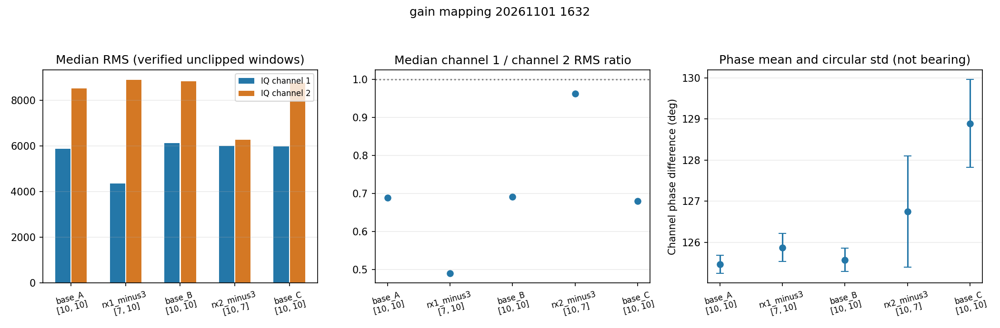
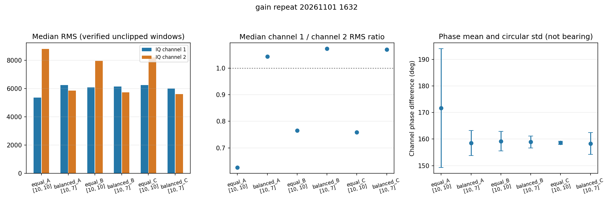
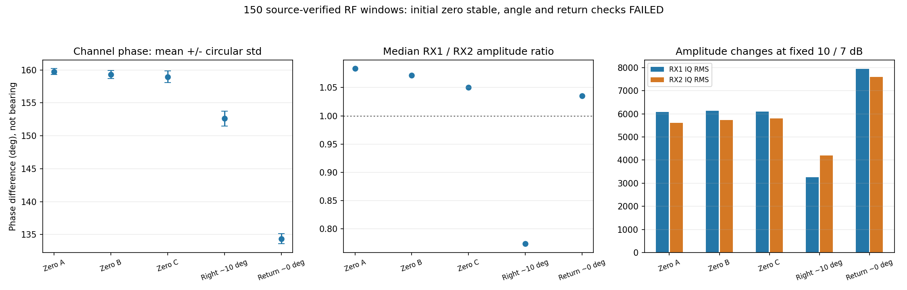

# 独立增益与单站 DOA 执行记录

承接 [后续测试与完整开发方案](h35_record.md)，按用户“ok执行”开展实现、离线复算和真实空口增益对照。没有重刷内核、FPGA、DTB或SD，也没有改ESP32固件。

后续补充见 [缓存与双路时序核查](h38_record.md)：用户明确确认当时已恢复零点；原150窗时间证据不支持整批慢一位置，另有13窗独立FIFO阳性对照/清空验证。更底层时序并未完全排除，13窗不混入本记录的390窗角度/增益实验统计。

## 一、已实现的软件

- `channel_capture.py` 与 `reference_capture.py` 新增 `--rx1-gain-db`、`--rx2-gain-db`，必须成对指定，和旧的同值参数互斥；旧接口保持兼容。
- 增益上下文逐路写入并读回，保存原模式与手动增益，部分写入失败或可处理的中断后恢复。增益不同的标定不能互用，新增了只变一路增益的拒绝检查。
- 新增 `gain_sequence_capture.py`：同一手动会话内运行有界阶段，跳过相同增益的重复写入，丢弃切换后前3窗，保存源代码快照、独立PCAP、配置和原始IQ。出现削顶则停止，结束恢复原配置。后续版本还支持等待用户摆放确认及原子PCAP检查点。
- 新增PC端 `ofdm_preamble.py`：按OpenOFDM公开LTS数值及重复64点结构检测前导，比较双路同一区段相位及子载波相位；不是已验收的正式测角器。
- 最终34项检查通过，包括独立增益与回退、原接口兼容、标定增益/RF会话不匹配、LTF检出、无信号/单音拒绝、阶段确认与PCAP检查点及不输出未标定方位。新增RF会话编号，防止重新进入增益模式后仅因增益数字相同而误用新会话标定；旧历史数据保留离线复算兼容。

## 二、旧有效连接数据的离线复算

`outdoor_secure_gain10_20261101_1514` 的60窗全部找到LTF，共同起点在样点87或88附近。相位圆周标准差：原方法为7.17°、4.17°、6.40°；固定LTF测相约为7.18°、4.25°、6.80°。因此不能说换固定前导就消除了旧数据的相位不稳。

LTS数值来自 [OpenOFDM公开参考](https://openofdm.readthedocs.io/en/latest/_downloads/lts.txt)。Windows直接下载返回403后，依据浏览工具已取得的公开数值转录为两列文件，未将下载失败描述为成功。资源及脚本SHA256已留存。

复算证据：`linux_doa/validation/offline_ltf_20261101_1632/`；原始数据仍在原目录，不覆盖。

## 三、小幅独立增益映射对照

顺序10/10 → 7/10 → 10/10 → 10/7 → 10/10，各12窗，共60窗；全部通过完整MAC/RID/FCS与53±1 µs硬件TSF对应，均无削顶。

| 阶段 | 两路增益dB | IQ1/IQ2 RMS中位数 | 逐窗幅度比中位数 | 相位均值 / 圆周标准差 |
|---|---|---|---:|---|
| A | 10/10 | 5869 / 8518 | 0.688 | 125.47° / 0.22° |
| 仅降低一路 | 7/10 | 4361 / 8894 | 0.490 | 125.87° / 0.34° |
| B | 10/10 | 6128 / 8840 | 0.691 | 125.57° / 0.28° |
| 仅降低另一路 | 10/7 | 5999 / 6277 | 0.963 | 126.75° / 1.35° |
| C | 10/10 | 5980 / 8778 | 0.679 | 128.89° / 1.07° |

结果支持IIO voltage0/voltage1分别影响IQ1/IQ2。当前电平关系已经与下午早先的2.8倍相反，不能照旧降低CH1约9 dB。用户随后重新确认参考源仍固定在约正前方1 m，天线间距5.9 cm；原因尚不能据此唯一定位。

证据：`linux_doa/validation/gain_mapping_20261101_1632/`。

## 四、10/10与10/7交错重复性

两组各3批、每批30窗，共180窗；全部通过完整来源核验及当前单窗相位质量筛选，无削顶。独立PCAP 6432帧，无接收线程错误或文件上限问题。

| 增益组 | 三批相位圆周标准差 | 结论 |
|---|---|---|
| 10/10 | 22.34°、3.67°、0.64° | 首批训练重复性未通过 |
| 10/7 | 4.74°、2.22°、4.09° | 幅度比约1.04～1.07；跨批次3°门槛未通过 |

10/7的参考相位约158.53°，后两批零点诊断平均偏差约0.49°、0.48°，但末批最大诊断偏差约7.29°。不能用较小平均误差或电平配平掩盖偶发跳变，不能宣布标定完成。

本轮没有降低方案中的3°门槛，也没有把不同增益混合归零。该交错序列本来包括增益切换；下一轮单独保持10/7，检查不切换时的零点重复性。

证据：`linux_doa/validation/gain_repeat_20261101_1632/`，包含 `zero_repeatability.json` 与对应源代码快照。该轮结束记录确认双路恢复 `fast_attack`，参考MAC触发关闭。

## 五、固定增益零点检查

新目录 `gain_angles_20261101_1632` 在用户确认几何后启动，三批全程保持10/7，同增益阶段只清FIFO、不重新写增益。三批均达到30窗后，先按原定3°标准差/3°均值偏移及来源质量门槛验收。通过才请求用户移动到已知左右角度；若失败则终止等待、恢复配置，进入接收链/同源输入诊断。

本节初始零点通过，但后续非零角和回零未通过，见第六、七节；该偏置不可作为正式测角标定。

首个启动目录在采样前因源代码快照目录重复创建而中止，无有效IQ；恢复记录正常。已修正这一脚本错误，保留失败目录，新增覆盖“创建源快照—恒定增益—用户确认—PCAP检查点—恢复”的完整模拟流程检查。该检查使用明确标记的合成数据，不计入实测窗口。修正后共33项检查通过，改用新目录 `gain_angles_20261101_1632_r1` 重跑，未覆盖已有实验。

重跑后恒定10/7的90窗全部完成来源核验及单窗质量筛选，无削顶；三批相位标准差0.456°、0.617°、0.889°，相对冻结参考的批均值偏移−0.042°、−0.473°、−0.825°，均通过预先声明的3°门槛。第一批前20窗参考偏置为159.7879257°，之后10/30/30个留出窗零点诊断MAE分别0.131°、0.171°、0.382°，最大0.283°、0.815°、0.631°。这是零点重复性通过，不是非零角度精度已经通过。

该轮同一RF会话保持10/7并进入 `waiting_right_10`，已请求用户将参考源从约正前方1 m位置向右平移约17.6 cm，确认后才采下一阶段。首个非零方向还用于核对阵列左右极性；若需反转符号，明确记录这一二值方向约定，不改变冻结相位偏置、不拟合角度比例，不能把符号校准点当作完全盲测。

## 六、首个右侧近似角度检查未通过

用户回复右移约17.6 cm，但明确表示不太精确。前向距离按约1 m记，名义角约9.982°，实际摆放公差未知。该数据不能当作精密转台真值。

30窗全部通过完整来源及相位质量检查，沿用冻结偏置159.7879257°；仅按已知右移方向确定原始相位约定需要乘−1，不修改角度比例。方向换算后平均诊断角约+2.381°，相对名义摆放的平均绝对差约7.601°、95分位约7.977°、最大约8.397°，未通过原定3°/5°角度检查门槛。

独立复算同一数据的LTF固定段结果约+2.277°，使用最初20个零点LTF训练、冻结的逐子载波单位复数参考后约+2.115°；没有按右侧数据重新训练。这个探索性结果不作部署，但支持“只换整窗平均方法尚未解决角度响应偏差”。

已请求用户恢复最初零点，保持同一RF会话与原偏置采回程；未把2.38°乘比例凑成10°。后续若继续采左侧，只作为未通过情况下的诊断对照，不能预写单站验收成功。

## 七、回零未复现，停止本轮角度验收

用户回复恢复后，采到30个真实双路IQ窗口，全部通过完整MAC、RID、FCS和53±1 µs唯一TSF关联，均无削顶。保持同一RF会话、10/7 dB实际增益和159.7879257°原偏置，不重新归零。

| 阶段 | 相位均值 / 圆周标准差 | IQ1/IQ2幅度比中位数 | 原偏置下平均诊断角 |
|---|---|---:|---:|
| 初始零点A | 159.746° / 0.456° | 1.083 | 近0°；训练与留出分开 |
| 初始零点B | 159.315° / 0.617° | 1.072 | 留出MAE 0.171° |
| 初始零点C | 158.963° / 0.889° | 1.050 | 留出MAE 0.382° |
| 右移约17.6 cm | 152.614° / 1.145° | 0.774 | +2.381°，名义位置约+9.982° |
| 返回原零点 | 134.371° / 0.768° | 1.035 | +8.465° |

返回零点的MAE为8.465°，95分位绝对误差8.923°，最大9.005°。固定LTF测相得到约+8.381°，固定逐子载波参考得到约+8.229°，同样没有复现最初零点。回零相位相对冻结偏置变化约−25.417°，而批内标准差小；高相干、幅度较平衡并不能证明方向准确。回零后两路RMS中位数约7937/7592，也与最初6079/5611不同。

这些结果支持“仅调平幅度或换前导平均尚不足以解决问题”，不能唯一断定是天线、接收芯片、电脑或环境反射造成。源位置、姿态、支撑和人体退出是否精确复现尚无量化记录，因此也必须保留摆放误差这个解释。当前不能用这一次回零直接证明接收机自身漂移。

在等待左侧摆放阶段主动向已核对身份的采样进程发送TERM，按既有退出逻辑恢复；没有采左侧和最终零点，没有把未执行阶段写为完成。`status.json` 中的 `aborted` 与 `KeyboardInterrupt: capture stopped by signal 15` 是主动终止记录，不是板卡掉线。

结束读回：双路 `fast_attack`；寄存器1=1、3=17、5=0、7=0、8=0、11=8190、12=4096，已去掉临时参考MAC触发。独立PCAP记录32737帧，无接收线程错误、未达到文件上限。串口按次开闭释放。RID主服务与Web地面站不因本轮实验退出而停止。

永久证据：`linux_doa/validation/gain_angles_20261101_1632_r1/`，共150个来源核验窗口；归档27258880字节，SHA256 `b8cf239c3ebec263db17a2eacd1aba02657109ac7037030ff550a34850537945`。其中保留实际运行的采集代码快照、PCAP、每窗SHA/TSF、原标定、阶段检查、LTF复算与完整清单。另有 `linux_doa/validation/latest_status.json` 明确 `production_bearing_enabled=false`、`calibration_reusable=false`。

本次新采集的三个有效实验分别为60、180、150窗，共390窗；未将旧60窗离线复算、启动失败目录、清FIFO丢弃窗口或测试合成数据重复计入。

## 八、下一步与当前可交付边界

逐路增益控制已经实现并得到空口映射验证；10/7仅是当前候选组合，不能固化成跨场景万能参数。单站绝对角度验收尚未通过，因此暂不接入正式方向箭头或双站交汇。

下一轮先做可重复机械几何：源的天线位置和朝向、接收阵列、电脑、线缆都有标记；同一点先连续静置，再以原支撑执行有标记的返回测试，保留冻结偏置。没有可靠位置复现前，不继续堆角度点或拟合比例。

用户随后补充：RX1、RX2到各自天线均接约20 cm SMA馈线，以便将两天线间距保持为5.9 cm；若直接插板端接口，间距仅约1.5 cm。保留当前馈线安装，DOA几何使用天线中心间距5.9 cm，不使用RX接口间距，也不将馈线长度加入空间基线。两根馈线标称长度相同不证明电气幅相响应一致；固定频率和配置下可标定固定通道相位差，但弯折、拉扯、接触和天线位置变化需另作控制。此信息来自用户安装描述，尚不是馈线电气测量，不据此断言馈线故障。

会话标识版 `channel_capture.py` 在本轮RF会话结束后才上传，板端语法检查通过，SHA256与本机一致：`4dad65de6bf590c9b9f6e98503da2b502211154555213b2ced4489bd41a6963a`。本轮实际采集用的旧版源码快照仍随原始证据保存，未替换成新文件。临时18781/18782导出服务已退出。约17:02检查地面站 `/api/rid`：HTTP200、connected=true、mode=live，仍实收参考RID，2437 MHz、6 Mbps、FCS有效。

若能借到合适的50Ω二路射频功分器及馈线，再做同源二分对照，区分接收通路与空中环境；用户尚不了解这些器材，目前不假设已有、不要求立即采购。无需功分器的下一轮操作与可直接接续的提示词见 [回零复现与接收通路排查提示](h37_record.md)。
