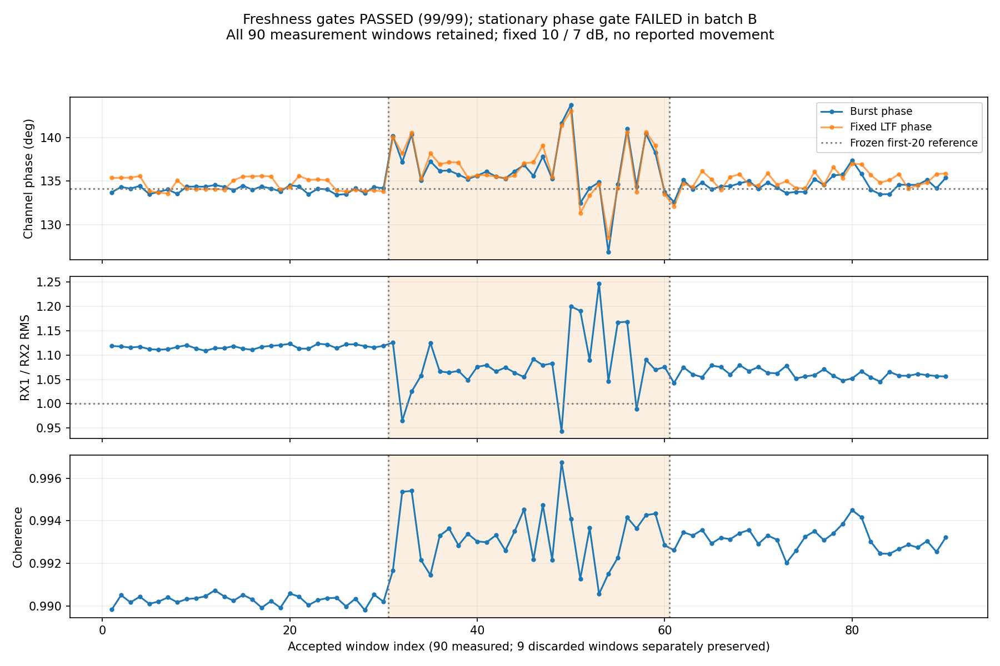

# DOA新鲜度门控复测

用户在 [缓存与双路时序核查](h38_record.md) 后明确要求“执行”。本轮落实“清空读回＋阶段硬件TSF新鲜度检查”，并在真实空口复测；保留现有FPGA、内核、DTB、天线和两根约20 cm SMA馈线。天线中心间距仍为5.9 cm，当前信道6。

## 已实现并部署

- 新增 `linux_doa/capture_freshness.py`，接入阶段采集器。每阶段保持side_ch复位约100 ms，两次FIFO计数必须均为0，读取必须返回−2；参考包须为完整源MAC且FCS有效、近期收到。记录复位前后时间和参考TSF，以参考TSF＋53 µs作为严格的新IQ时间界限。
- 本轮全程检查IQ时戳严格递增、不能早于阶段界限、去掉头部后的IQ内容不能重复。任一失败即保留拒绝窗口和原因、中止本轮并恢复配置，不靠换新TSF掩盖旧内容。
- 前3个丢弃窗也保存原始数据、哈希与时间；普通采集窗口记录时间界限及内容哈希。每阶段有单独 `freshness.json`，实际运行源码随采集保存。
- PC端 `verify_stage_freshness.py` 根据原始IQ、日志和独立PCAP重新检查，包含完整MAC/RID/FCS及唯一53±1 µs关联，不只相信板端布尔字段。
- 43项软件检查通过，含旧内容换新时戳、时戳重复/倒退、未清空FIFO、无近期参考及完整流程故障恢复。合成测试不计入RF窗口。

## 本轮采样约定

新目录 `fresh_angles_20261101_1713`。沿用用户最近明确确认的“已返回原正前方约1 m”位置，期间未报告再次移动；本轮开始告知保持不动。三批均使用同一RF会话、10/7 dB候选增益，无重新调谐。只在三批零点通过后通知用户移动；右移、回零、左移均需明确完成确认后才创建对应ready文件。

先采3×30窗静置数据，每批另保存3个丢弃窗；首批前20个合格窗训练新参考，10/30/30个留出窗评估。旧159.7879257°偏置不投入本轮。同会话编号和两路增益必须匹配。沿用原门槛：每批至少30窗、合格率≥90%、相位标准差≤3°、批均值相对冻结参考偏移≤3°，不因结果不好放宽。

三批各30窗均采完，另保存9个丢弃窗。**99/99通过PC端独立新鲜度、哈希和完整来源关联**；三次FIFO清空读回均为0/0、−2，所有窗口晚于各自阶段界限、时戳递增、IQ内容不重复。90个测量窗均未削顶、均通过当前单窗质量筛选。

本轮正式bearing保持关闭。临时参考MAC触发仅用于本次有界复测，结束必须恢复全信道触发和原增益模式。Web地面站与RID主服务保留。

## 静置相位门槛未通过

用户进一步明确：刚才三批采样期间设备都没动，也没有人靠近。记录为无已知主动移动，不能拿手持或走动解释本轮；也不能由此证明环境没有其他射频或传播变化。

冻结首批前20窗得到本轮候选相位偏置134.1343990°。新会话不套旧159.7879257°，本轮候选也不投入正式角度。结果如下，注意表中相位标准差不等于角度误差：

| 批次 | 相位均值 | 相位圆周标准差 | 相对冻结参考均值偏移 | 留出零点诊断MAE / 最大绝对误差 | 门槛 |
|---|---:|---:|---:|---:|---|
| A | 134.064° | 0.347° | −0.071° | 0.103° / 0.237°（10窗） | 通过 |
| B | 136.462° | 3.123° | +2.327° | 0.979° / 3.199°（30窗） | 相位标准差超过3°，未通过 |
| C | 134.576° | 0.894° | +0.442° | 0.244° / 1.079°（30窗） | 通过 |

B批相位约126.836～143.768°，不是一个重复旧窗造成的整批定值。其幅度比同时有变化，但相干度仍高。固定LTF相位标准差约3.075°，同样略超门槛；不能声称换前导就解决。本轮没有删掉B批窗口，也没有把3°门槛改成更宽的数值。

当前A批134.064°与上一轮回零134.371°接近，而上一轮右移约152.614°。这是进一步不支持“回零整批读到右移旧数据”的线索；跨RF会话的数值接近仍不能单独证明通道标定可跨会话复用，也不能唯一定位偏差原因。

## 本轮结束状态与证据

由于静置总门槛未通过，在 `waiting_right_10` 阶段主动TERM停止已核对身份的采样进程，没有让用户移动，也没有采右/回零/左侧。日志的 `aborted` 和signal 15是主动结束，不是硬件掉线。

结束读回双路fast_attack，寄存器1=1、3=17、5=0、7=0、8=0、11=8190、12=4096；参考MAC触发关闭，恢复全信道配置。PCAP共3747帧，无接收线程错误，未触及文件上限；临时18784/18785导出后台已退出，串口按次释放。随后地面站 `/api/rid` 仍为connected=true、mode=live、有1个目标、error=null。

永久证据在 `linux_doa/validation/fresh_angles_20261101_1713/`，含实际执行源码、90个测量窗、9个丢弃窗、PCAP、阶段清空日志、逐窗拒绝机制、独立新鲜度核验、候选标定/留出结果、LTF复算、逐窗诊断图及SHA清单。归档6748160字节，SHA256 `3d056b8b94a311aced6bd2b70d207cb1a1da77e449b56e5b8a74ea6d29c61026`。`validation/latest_status.json` 已更新：FIFO/新鲜度通过、静置相位门槛失败、正式bearing关闭、标定不可复用。

本轮完成的是新鲜度检查功能及真实复测，尚未完成单站角度验收。下一步优先检查通道相位稳定性及逐窗实际配置，不再反复调零或默认旧数据。接续提示见 [相位稳定性排查](h40_record.md)。
