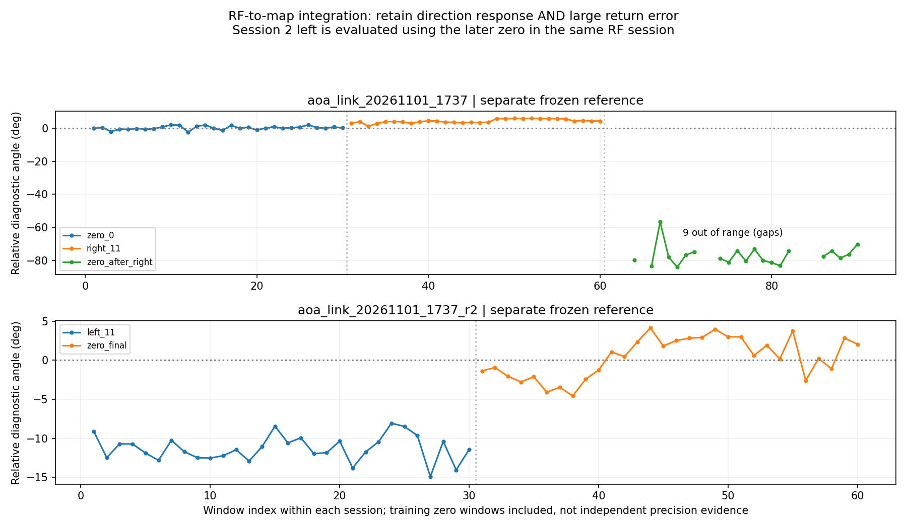

# AoA单站地图接入与双站联调执行

承接用户批准的 [全链路优先提示](h41_record.md)。本轮按“先贯通、再调精度”执行，不再以3°相位标准差阻断左右测试和地图接入。数据新鲜度、来源、削顶与可反演范围仍检查。当前记录覆盖站A真实接入；第二站和地图现场确认随实际完成补入。

## 一、已接通的真实数据路径

天线 → AD9361双RX → OpenWiFi/side_ch双路IQ → 开发板HTTP导出原始窗口和参考帧 → PC独立核验MAC/RID/FCS/TSF → 相位/相对角 → 地面站 `/api/doa` → 浏览器持续轮询 → 原有DOA面板与地图绘图入口。

测角信号来自真实天线和双RX采样。COM9仅用于启动、配置和状态读取，没有把ESP32串口日志当作接收结果。未重刷FPGA、内核、DTB、SD或ESP32固件。

当前实时观测是**已知ESP32参考源的有界联调**，不是所有协议实时测向已经完成。参考源为 `mac_aa98f353b5`、`RIDTEST-ESP32S3-0001`，信道6；主RID/monitor仍接收当前通道，未改成永久白名单。接口明确 `demo=false`、`scope=bounded_reference_source_integration`、`precisionValidated=false`，真实联调显示与正式精度验收分开。

## 二、零点、右移、回零、左移的实测

用户重新摆好并明确确认本轮零点；距阵列按约1 m记录，未精密量取。天线间距5.9 cm，每路约20 cm SMA馈线。左右横移均按约20 cm、前向约1 m，名义角约±11.3°，摆放公差未知。

### 第一会话：`aoa_link_20261101_1737`

同一10/7 dB会话，零点前20窗建立临时偏置75.391253°，训练相位离散度3.708°。不因超过3°停止。右侧点只确定一次二值方向符号为+1，未改相位偏置或拟合角度比例。

| 位置 | 核验测量窗 | 可反演角度窗 | 诊断结果 |
|---|---:|---:|---|
| 初始零点 | 30 | 使用前20窗训练，留出10窗 | 临时参考；不把训练归零当作精度证明 |
| 右移约20 cm | 30 | 30 | 平均+4.248°，方向有响应，幅度小于名义+11.3° |
| 回到标记零点 | 30 | 21 | 可反演部分平均−76.884°；另9窗超出当前模型可反演范围，未强行夹角或重归零 |

这次回零变化很大，不能称角度精度已够用或回零已复现。按用户新优先级，保留异常并继续传输/界面工作，不把接口连通写成测角正确。

初始零点的10个留出窗诊断MAE约0.494°，与随后回程的大误差分开记录，不能用初始留出良好替代回零验证。

等待左侧摆放时，背景帧使16 MB PCAP上限触发，采样自动结束并恢复fast_attack和全信道寄存器。助手此前低估了等待期间的背景帧量；该中断如实保留，不能把之后的数据仍标成同一RF会话。

第一会话保存90个测量窗＋9个丢弃窗，全部通过来源/新鲜度核验，无测量窗削顶。归档32552960字节，SHA256 `56d68abbc9376fca2f72379d3b57a91c512b355c16bbfa8d26872300309c93ff`。永久证据：`linux_doa/validation/aoa_link_20261101_1737/`。

### 第二会话：`aoa_link_20261101_1737_r2`

容量修正为：本次有界参考实验只将FCS有效的完整参考源MAC帧写入证据PCAP；主monitor/RID的接收范围不改变。用户已固定在左侧，故先采左侧，再按原计划回最终零点，在同一个新会话内用最终零点建立参考并**回算**左侧。没有要求额外往返，也没有套第一会话偏置。

用户明确回复“已恢复最终零点”后才采最终参考。新偏置−146.727391°，训练前20窗的相位离散度8.289°；按联调要求如实记录，不当成正式标定通过。左右符号沿用已记录的+1，不根据左侧结果再次拟合。

| 位置 | 核验测量窗 | 结果与限制 |
|---|---:|---|
| 左移约20 cm | 30 | 用随后同会话零点回算，平均−11.281°；相对名义几何MAE 1.312°、95分位3.075°，摆放不精确，不能当精密转台真值 |
| 最终零点 | 30 | 前20窗训练、后10窗留出；训练参考用于本会话实时观测，不跨会话复用 |

最终零点的10个留出窗诊断MAE约1.828°。本轮两个会话共150个测量窗＋15个丢弃窗，165/165完成独立新鲜度与来源核查；实时环形窗口另计，不重复混入这个分母。

此段保存60个测量窗＋6个丢弃窗，全部通过独立来源和新鲜度核查，无测量窗削顶。该段只验证了新会话内“左侧相对零点”的响应；不能与第一会话右侧拼成同一冻结偏置下的左右对称精度验收。

已在实时采集不中断的情况下保存冻结阶段快照：2437120字节，SHA256 `2694aca51c4a1f1c0e953398594b01def79d3e598f422cad4a596e2eda8cc7dc`。永久证据：`linux_doa/validation/aoa_link_20261101_1737_r2/`。快照状态为live、rf_restored=false，这是当时实时会话仍在运行的记录。

## 三、地面站改动与现场状态

- 新增 `ground_station/doa_bridge.py`，通过以太网取原始IQ和参考帧，检查哈希、新鲜度、标定会话、完整来源以及物理反演范围，生成真实相对角。
- `serve.py` 增加只读 `/api/doa` 和站点配置入口；保留18770原服务和RID18771桥接。
- 新增 `doa-live.js`，每0.5 s读取观测；模拟模式与迟到真实响应隔离，过期/断流可识别。
- `data.js` 保留无坐标站点的相对角、相对0°、各站新鲜度及来源。站B未接入时明确显示等待。
- 原地图增加单独的联调锚点、A/B朝向与局部东/北位置配置，射线长度默认10 m；没有改变电脑蓝点的定义。
- 相对角右正左负，地图方向为“站点朝向＋相对角”；没有把相对0°当作真北，没有从RID航向或GPS反算DOA。
- 两站各自独立轮询，B超时不阻塞A；只保留有限近期观测，避免旧角度被轮询时间伪装成新数据。

实际连续接口快照已保存：两次硬件TSF分别10311597054、10313596398，相对角约−0.745°、−1.674°，数据年龄约0.332 s、0.082 s，均connected=true、来源核验有效。它们是两个真实新窗口，非一次性手工粘贴的离线角度。

用户已通过新页面选定联调地图锚点，并保存站A朝向300°。接口已给出站A地图坐标和随相对角变化的地图方位；例如某次相对角约−6.525°时，地图方位约293.475°。锚点和朝向来自用户联调设置，不作为米级/角度真值保证。

Windows界面自动化辅助进程不可连接，重试和重建会话后仍失败，错误为 `Computer Use native pipe is unavailable ... os error 2`。因此未声称已完成截图视觉验收；已有接口、JS检查、用户实际配置写入和页面访问证据，仍等待用户对现场显示的反馈。

## 四、双站软件已准备，真实第二站尚待接入

新增 `doa_geometry.py`，使用局部米制坐标和前向射线求交，处理近乎平行、背向交点、缺站、观测过期、时差过大及目标不匹配，不制造交点或置信半径。站点位置通过同一个联调锚点投影到地图，电脑位置不作默认站点。

双站观测进一步按**同一空口帧内容指纹**配对，在两站有限近期队列中找共同帧，避免直接拼接两站不同包。当前参考源最近128帧的指纹128个不同；MAC序列字段恒定，但Beacon时间戳128个不同，指纹可区分这些周期。两站硬件TSF仍各自独立，不把其数值当作共同时钟。若未来发射帧全部字节恒定，内容指纹不能独立区分周期，还必须结合时效窗或其他信息。

双站交汇与同帧配对已用明确标注的测试向量检验，**尚未有真实第二台设备的双站交汇结果**。站B配置保持未接入，未用站A数据复制成站B。

已通知用户：B先上电接USB串口和自己的双RX天线，暂不接网线，先避免相同默认IP；保持站A接线不动。只读盘点时，A使用Realtek USB千兆网口，电脑自带Realtek网口空闲；串口基线为COM3/4/5/6/7/8/9/10/12。`board.ps1`已支持显式PortName，默认COM9不变。接入B后依据新增端口和实际设备核对，不猜串口号，不重刷已工作站A。

## 五、验证、运行边界与后续

- Linux侧43项采集/新鲜度/恢复检查通过。
- 地面站Python侧15项检查通过，包含电脑定位兼容、双站前向交汇、过期/错目标/错帧拒绝、近期共同帧选择、B阻塞时A继续更新，以及实际HTTP读取/配置、0度和零坐标保留、非法配置不部分覆盖。
- 前端数据、DOA实时连接、RID实时连接、地图位置控制检查通过；新增JS语法检查通过。
- 所有测角图形仍标“实测／临时标定／精度待优化”。本轮真正打通的已知部分是站A实时观测到现有地面站；角度稳定性与回零大偏差仍未解决。

站A实时尾段有一小时上限，IQ文件按128窗环形保存，PCAP仅保存参考源帧；到期或收到停止信号后恢复原配置。保留固定手动增益期间，原会话参考才适用；重启/模式重入须重建参考。实时服务是否仍在线以当时接口/状态读取为准，不能把本报告当永久在线保证。

下一步按用户批准主线继续：确认现场地图射线 → 接B并配置独立网络与标定 → 配置实测站间位置/朝向 → 同帧双站角观测和试验交汇进入地图。精度优化在链路贯通后集中处理，不能把软件交汇测试写成真实双站已完成。

综合证据在 `linux_doa/validation/aoa_link_integration_20261101_1737/`，包括两个会话的参考、逐窗相对角、165窗核查、实时接口连续快照、用户站点配置及当前地面站源码。根目录 `validation/latest_status.json` 区分 `integration_display_enabled=true` 与 `precision_validated=false`、`real_dual_station_intersection_completed=false`。接续操作见 [双站设备接入提示](h43_record.md)。
