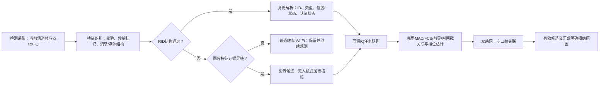

# 空域知微四级处理链与RID识别调研实测报告

记录时间：2026-11-02 12:43。当前入口：http://127.0.0.1:18770/#/signals 。

## 本轮结论

已把系统组织为“检测采集—特征识别—身份解析—测向定位”，完成板端部署和真实双站RID链路验证。测向不再在程序中永久绑定ESP32的MAC或RID，改为识别结果驱动的同源IQ任务队列；当前只有ESP32 RID在现场通过完整链路实测，非RID图传分支已接入软件规则和调度，尚未完成新的实机图传验收。

目前软件参数仍为每站天线中心距6.0厘米、两站中点间距2.8米，实物未按新尺寸摆好。用户已授权在现状下先测，因此当前角度和交汇均是**未校准诊断结果**，使用零相位偏置，不作为定位精度结论。旧相位参考文件保持原样，没有建立新零点，也没有拟合当前信源角度。下午摆正距离后，仍须按新射频会话重新标定；距离摆正本身不会消除通道相位偏差。

## 四级层级与分支

第一层不以RID为接收白名单；当前信道内可解码的发送端都进入信源列表，坏FCS帧可在原始帧表中观察，但不产生可信MAC身份或测向目标。当前接收覆盖为信道6、2437 MHz、20 MHz、可解码OFDM Wi-Fi；**这不是全频段、所有调制或所有射频信号的完整检测**。BLE、DSSS/CCK、模拟FPV及其他频点需要独立接收/解调能力，不能靠网页规则补出来。

第二层只做有依据的分类：RID广播、RID格式候选、Wi-Fi图传候选、普通/未知Wi-Fi。第三层解析广播自报身份和消息；没有RID的图传候选不虚构实名ID。第四层才调度对应发送端的IQ，对完整源与帧进行关联后估计相位，并在两站同帧时求交。RID广播位置和独立DOA交汇分开显示，不把RID航向、操作员位置或电脑位置当作测向角或无人机坐标。

## RID识别调研与实际覆盖

RID不能只靠SSID含“RID”、某个MAC前缀、2.4 GHz或固定速率识别。关键是传输封装、专用标识、载荷结构与校验共同成立。[OpenDroneID官方实现](https://github.com/opendroneid/opendroneid-core-c/blob/master/libopendroneid/wifi.c)

| 载体/类型 | 识别特征 | 当前状态 |
| --- | --- | --- |
| Wi-Fi Beacon ODID | Beacon中IE 221；OUI FA:0B:BC；类型0x0D；计数器及RID载荷 | 已接入；ESP32真实空口通过 |
| Wi-Fi NAN ODID | Public Action的04/09与50:6F:9A/13；服务标识mac_a2d0e30818；服务信息载荷 | 已实现既有固定描述符布局和软件用例；可选布局不冒认通过，实机待验 |
| BLE传统/扩展广播 | Service Data中的16位UUID 0xFFFA、应用码0x0D及RID消息；空口为蓝牙接收链 | 已调研，当前OFDM接收链未接入BLE |
| 国标运行识别、厂商私有身份格式 | 必须分别核对标准版本、传输和真实包，不能仅由产品宣传推断逐字节兼容 | 本轮不宣称GB全格式兼容；保留适配与样本验证任务 |
| 网络式身份数据 | 需相应网络数据接口及身份关联，不能由空口SSID代替 | 未接入 |

BLE字段依据[官方蓝牙发送实现](https://github.com/opendroneid/transmitter-linux/blob/main/bluetooth.c)。国标现行信息已核对[GB 46750—2025官方条目](https://std.samr.gov.cn//gb/search/gbDetailed?id=42BD8BAE300A08A1E06397BE0A0AB162)及[GB 42590—2023官方条目](https://openstd.samr.gov.cn/bzgk/std/newGbInfo?hcno=0DC41035BA23EF2C5B94E6482492AF1E)；GB 46750实施日期为2026-05-01。本轮民航局附件PDF获取超时，未据未读附件编造字段或宣称完成国标认证。

当前解析器覆盖0～2版ODID消息：Basic ID、Location/Vector、Authentication、Self ID、System、Operator ID，以及25字节消息组成的Message Pack。专用标识匹配但长度、版本或消息结构不通过时，仅显示RID候选；无有效Location时仍可识别身份并做独立测向。认证消息被保留，但没有完成签名验证，因此“识别RID”不等于“已验证无人机身份真实性”。

## 非RID图传分支

增加可见RTP视频型载荷、连续序列/同一流、MPEG-TS同步结构、持续大数据帧、UDP及SSID组合证据。连续RTP视频结构参照[RTP标准](https://www.rfc-editor.org/rfc/rfc3550)和[H.264载荷规范](https://www.rfc-editor.org/rfc/rfc6184)。动态载荷类型没有SDP时仍只作视频型候选。

当前证据分规则：相关SSID词30分；持续大数据帧20分；多帧UDP15分；大帧集中于少数接收端10分；连续媒体结构55分；达到50分才进入候选测向，显示分数上限75。它是工程启发式证据分，不是经过数据集校准的无人机概率。高流量UDP单独不足以归类无人机；网络摄像头也可能符合媒体特征，因此候选明确标为“无人机待核验”。加密载荷不会被假装解密。

本轮未开启新的无人机图传，现场实时分类没有验证出图传候选。现有历史图传电源对照仍仅属于其当时信道1、设备和场景，不自动变成当前信道6的实测结论。下午可按独立开/关机、视频开/停和普通视频设备负样本建立更可靠的候选规则。

## 测向与硬件链路

两站通用IQ服务运行在18788端口，帧/RID/资源服务运行在18771端口，本机18770统一提供网页。每轮最多调度16个新鲜合格候选，按约5秒时片轮询；也可在信源检测页选定某个已识别信源，或恢复自动轮询。任务租约15秒，失去控制端后过期停止该目标采样；采集服务最长运行1小时，正常停止会恢复先前增益模式和采集寄存器。不是无间隙多目标IQ记录。

板端沿用已验证的配对IQ驱动与固定0 dB双RX会话，不修改BOOT.BIN或FPGA比特流。硬件低32位MAC筛选仅作调度，完整身份还要通过监测包的六字节MAC、有效FCS、原始帧SHA256、硬件TSF和IQ前导位置共同核对。PC执行现有OFDM LTF子载波相位提取；不能把这部分计算计入FPGA动态负载。

复核发现旧53±1微秒时差仅由6 Mbps参考帧验证。最终版通过实际LTF起始样本位置核对SIGNAL锁存TSF与ADDR2触发TSF：本配置1536个预触发采样、20 MS/s，采用既有24个真实窗口与HDL核对得到的约19微秒锁存差，容差1.5微秒。对候选参考包要求唯一匹配，不猜最近一帧。这是采集时间关联，**不是角度零点标定**。其他速率的软件用例已通过，仍需图传空口独立验证；HT/其他触发配置不自动沿用此结论。

双站只对同一目标、同一原始空口帧的新鲜角度求交。前后镜像候选、近乎平行拒绝、弱几何标识、50米默认显示线和中点相对坐标均保留。未校准阶段可能有交点，也可能全部被拒绝；不能为展示效果拼接异帧或强行生成位置。

相位超出名义阵列反演范围时，仍显示新鲜原始相位和“角度不可反演”，不给出截断/伪造角度，也不把旧角度刷新成新观测。多目标切换会清空当前角度趋势，避免把不同MAC的角度连成同一条运动轨迹。

## 真实实测结果

| 项目 | 初版时序链路 | 最终前导辅助关联版 |
| --- | --- | --- |
| 采样快照 | 35 | 20 |
| 双站同帧快照 | 35 | 20 |
| 不同同帧配对 | 27 | 13 |
| 存在诊断交汇的快照 | 35 | 0 |
| 各站下载并独立复算IQ | A12、B12 | A12、B12 |

真实来源为RIDTEST-ESP32S3-0001，MAC mac_aa98f353b5，两站均接收。数值来自天线→射频/FPGA→板端监测/IQ→以太网→PC，不来自ESP32串口。两轮重入射频会话后原始相位会变化；最终段没有有效交汇，其最后原因是“两条方位线接近平行”。两轮均未校准，不能用第一段的交点来证明定位正确，也不能把最终段的拒绝隐藏掉。

最终保存的RID快照中Location仍为未知；System中的参考/操作员位置不是无人机当前位置。部分早先包出现过有效坐标字段，均仅为模块广播自报，没有独立核验GNSS真实性与精度。

## 资源占用百分比

| 资源 | A | B | 含义 |
| --- | --- | --- | --- |
| CPU | 约73.6% | 约18.4% | 最终采样窗口内平均；双核整体繁忙率，排除idle/iowait |
| 内存 | 约21.0% | 约16.0% | 该窗口末次MemAvailable口径 |
| LUT | 18.52% | 18.52% | FPGA静态资源占用 |
| 寄存器 | 12.48% | 12.48% | FPGA静态资源占用 |
| BRAM | 29.54% | 29.54% | FPGA静态资源占用 |
| DSP | 17.11% | 17.11% | FPGA静态资源占用 |

CPU和内存从各板Linux /proc实时读取，已放入“设备与布站→平台资源”。FPGA百分比来自2026-10-27的Routed实现报告`openwifi_timing_fix_20261027_1708/impl_utilization.rpt`；两站SD上的BOOT.BIN SHA256均与相应构建清单一致，未进行当前活动配置读回。静态占用不是实时工作效率，不能把各项简单平均成一个“板卡利用率”。

A站CPU占用明显高于B。只读进程快照显示监测服务、IQ服务及桌面/系统服务均有占用；ps的进程生命周期占用与/proc的短时整机口径不同，不能直接相加或当作同一统计量。后续可优化帧检查、JSON序列化和桌面后台，当前没有擅自关闭实验室其他系统服务。

## 交付与验证

- 新增/修改：RID结构识别、媒体特征、板端资源采样、通用目标IQ采样、PC处理链/调度、前端四级面板、身份依据详情、选定/自动任务、资源百分比、地图与仪表的未校准标识。
- A/B各6个最终部署文件逐项SHA256匹配；各自保留板端备份；原相位参考字节未改。
- 73项后端、25项接收/解析、8组前端回归通过；36项既有DOM/隔离HTTP交互通过；8项真实硬件HTTP→DOM/假Leaflet检查通过，另有原始相位显示及目标切换趋势DOM检查。
- 原生界面工具报告native pipe unavailable，本轮没有浏览器截图/CSS目视验收；DOM不替代实际浏览器视觉验证。
- 正式网页与双站接收保留运行，串口已释放；隔离验收服务结束后关闭。刷新旧页面按Ctrl+F5。

本轮全部证据位于`tmp/pipeline_20261102_1204/`：最终部署日志、manifest.json、live_summary.json、live_summary_initial.json、两轮原始IQ及配套监测包/元数据、final_pipeline.json、final_doa.json、final_checks.json、dom_acceptance.json、live_dom.json。继续执行见同时间的外场接续提示词。
