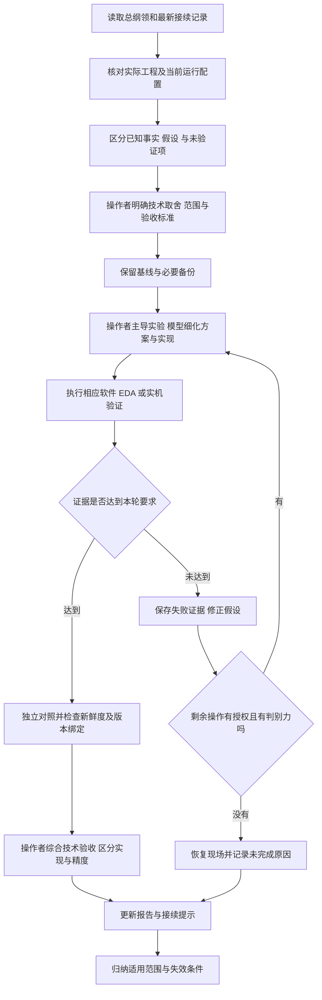

# 空域知微大模型协作记录

本文记录 Zynq XC7Z045 与 AD9361 无人机侦测定位系统开发中，大模型如何参与工程分析、代码修改、验证设计与结论修订，并将已经在项目中使用的排查方法整理为可复用提示词工作流。内容涵盖提示词、模型回答、工具反馈、自我纠错轨迹、软硬件分工及技能提炼过程，可作为初赛设计报告的协作过程附件。

**归档日期：2026 年 11 月 4 日。历史协作材料覆盖 2026 年 10 月 23 日至 11 月 3 日；归档不代表在 11 月 4 日重新完成了实机验收。** 全文使用站点 A、站点 B、操作者与模型等技术角色，不包含参赛单位和个人身份资料；无线报文中的设备标识、原始网络名称、精确地理位置及本机用户目录也不在本文展开。

协作形成的主要成果是：建立可继续构建的 OpenWiFi 板级工程，排查并修复初始化和时序问题，验证真实空口接收与同帧关联，将单站 DOA 计算及信源评分部署到板端，并把异常拒绝、基准隔离、任务调度与运行恢复纳入系统流程。**接收链跑通、算法迁移等价、输出短时稳定，分别证明不同能力，均不能单独作为绝对测向或定位精度达标的依据。**

可复用技能入口见 [skill/README.md](../skill/README.md)。

## 目录

- [1 记录依据与版本取舍](#1-记录依据与版本取舍)
- [2 人机协作分工与最终系统架构](#2-人机协作分工与最终系统架构)
- [3 主要协作过程总览](#3-主要协作过程总览)
- [4 典型交互与自我纠错轨迹](#4-典型交互与自我纠错轨迹)
- [5 智能体工作流设计](#5-智能体工作流设计)
- [6 技能提炼过程](#6-技能提炼过程)
- [7 协作效果与证据边界](#7-协作效果与证据边界)
- [8 复现与接续](#8-复现与接续)
- [9 重点来源与证据索引](#9-重点来源与证据索引)
- [10 历史材料完整目录](#10-历史材料完整目录)

## 1 记录依据与版本取舍

### 1.1 材料范围与记录性质

主要依据为工作区 `提示词/` 中的 **93 份 Markdown 文件，包括 1 份总纲领和 92 份带日期的提示词、执行报告、验收报告或接续记录**。第 10 节给出逐份目录，重点案例的来源在第 9 节对应。93 份文件不等于 93 次独立实验，也不等于 93 轮完整对话。

历史材料同时包含任务下达、执行结果和后续补充。本文采用以下标记，避免把整理后的文字误当逐字聊天记录：

- **提示词原文节选**：直接摘自已归档提示词；只选取与技术任务有关的连续文字。
- **提示词或需求摘要**：根据任务说明、执行报告中的需求回顾整理，属于归纳文字。
- **模型回答原文节选**：直接摘自归档的执行报告或验收报告。
- **模型产出摘要**：归纳报告记录的分析、修改和交付，不补造未保留的对话。
- **纠错轨迹**：列明原判断或方法、反证、新事实、实际修订及验证边界。工具返回错误不自动等于设计错误。

本文不补填历史材料未记载的具体模型版本、调用次数、Token 总量、人员身份或节省工时，也不把工作流中的多个职责角色描述成已经部署的多个自治模型。

### 1.2 版本和事实的采用顺序

1. **总纲领优先确定系统主线。** 以其四级处理链、A/B/PC 分工、固定布站、板端计算和使用边界组织本文。
2. **日期较后的明确修订优先于较早阶段结论。** 同一问题同时查看文件中的执行时间和追加说明，不只按文件名前缀排序。早期文件内的晚期补充也属于后续修订。新文件若只是待执行计划，不能覆盖已验证事实；不同配置下的新结果也不能直接推翻旧配置下的结论。
3. **具体实测限定概括性表述。** 例如“已产生角度”只说明当次有输出；是否通过参考适用性、独立位置验证和绝对精度验收，需要各自证据。
4. **区分需求、实现与验收。** “请支持”“已经写好”“已经部署”“当前实收通过”是四种不同状态，不能互相替代。
5. **矛盾保留发生条件。** 频点、阵距、基线、接收角色、采集会话和算法版本不同的数据，保留为各阶段证据，不混合计算统一性能。

### 1.3 必须保留的关键版本修订

| 主题 | 早期阶段记录 | 本文采用的后续状态 |
| --- | --- | --- |
| 硬件布站 | 曾使用 A 阵距 5.9 cm、B 阵距 7 cm、站距 76.5 cm 的室内联调布局 | 总纲领规定 A 右 B 左、站距 2.8 m、各站阵距 6 cm，参考点在中点前方 3 m；旧布局数据只属于原实验 |
| IQ 运行方式 | 手动受控会话默认约 3600 秒结束 | 11 月 3 日两站已配置永久自启动及 `--seconds 0`；常驻进程按目标租约采集窗口，不代表连续全带宽搬运 |
| 单站 DOA 位置 | PC 下载 IQ 后计算 | 11 月 3 日已迁至 A/B 各自 Linux CPU；PC 汇总结果、检查关联并几何交汇 |
| 信源识别位置 | 早期识别和评分位于 PC | 11 月 3 日 04:25 记录确认识别评分迁到 A；B 提取观测，PC 原样转发及调度 |
| 频段覆盖 | 历史独立扫描不等于实时覆盖 | 已接入 24 个可设信道的 2.4/5 GHz 逐信道轮扫；后续保留的固定信道配置不代表轮扫功能被删除，5.8 GHz 不在当前覆盖内 |
| 参考复用 | 曾严格按会话拒绝旧参考，后按授权允许户外固定参考跨会话使用 | 11 月 3 日 12:16 及其后续补充保留默认固定复用策略，同时要求面板新建基准的会话核验、采集恢复和生效状态隔离；不将默认授权扩展为所有旧基准均有效 |
| DSSS 能力 | 早期只有仿真、PHY 头部和短帧诊断 | B 已部署 1 Mbps DBPSK 长前导完整帧接收；接收、RID 解析和实时网页贯通分别判断，DSSS 测向未因此完成 |

**基准的最新口径尤其重要。** 11 月 3 日 11:21 的原位核验失败，针对当时选用的面板保存基准；12:16 后恢复并重新下发的默认固定基准属于另一条策略。后续确认两站接收了默认上下文，不等于重测了相位或证明前述失败基准已经通过。本文不把两份基准、两种策略、不同时间的在线状态合成同一次验收。

## 2 人机协作分工与最终系统架构

### 2.1 人机分工

操作者承担工程技术负责人的职责，主导系统级取舍、精密实验与关键结论判断；模型承担方案分析、实现辅助、工具调用和证据整理。下表及第 2.4 节明确可复用工作流中的职责分配，历史任务的实际贡献仍以第 4 节及原始记录为准。

| 参与角色 | 主要职责 | 交接给下一环节的内容 |
| --- | --- | --- |
| 操作者 | 主导系统目标、软硬件划分和技术路线取舍；确定阵列几何、标定策略与实验条件；承担精密物理操作、复杂故障的工程判断及最终验收结论 | 技术约束、方案取舍依据、现场测量或操作记录、验收标准及结论适用范围 |
| 大模型 | 在既定技术目标与范围内阅读工程、推演候选方案、分析日志、编写代码与脚本、调用工具验证，整理反例与纠错；为复杂判断提供可核查依据 | 方案比较、计算与实现结果、工具证据、差异及不确定项、下一轮接续记录 |
| EDA 与软件验证工具 | 产生综合实现、时序、资源、仿真、协议解析和回归结果 | 日志、报告、退出码、原始样本和对照结果 |
| 实际 A/B 板卡 | 验证启动、射频、完整帧接收、同步 IQ、板端识别和 DOA 的真实行为 | 硬件读回、实收帧、IQ 窗口、服务状态和结果计数 |
| 归档环节 | 对应需求、修改、原始证据、结论与接续任务 | 可追溯的版本记录和本文技能工作流 |

软件模型无法通过代码直接确认接头是否拧紧、信源是否已经移动或现场传播条件是否保持不变。因此物理条件需要独立记录；操作者补充事实后，模型必须重新评估原实验的因果解释。

### 2.2 最终系统分工

```text
B 站 FPGA      OFDM 接收及已集成的 DSSS 支路  双 RX 同步 IQ
B 站 Linux     完整帧与可见协议字段提取  RID 解析  本机单站 DOA
                          │ 结构化观测
                          ▼
PC 原样转发 ───────────→ A 站 Linux
                          信源分类  六项候选评分  RID 或 AOA 分流
A 站 FPGA                 本机双 RX 同步 IQ
A 站 Linux                本机单站 DOA
                          │
A 与 B 的结果 ──────────→ PC 轻量调度与结果汇总
                          同频控制  任务续租  同目标同帧检查
                          双站几何交汇  地图与轨迹展示
```

FPGA 承担接收基带、同步采样、缓存和 DMA，单站角度与识别运行在板端 Linux CPU。两站位于分别连接 PC 的独立网段，当前 PC 仍承担必要的转发与协同，不能将其描述为脱离 PC 的完整自主双站系统。

### 2.3 算法和协议的解释边界

- RID 有新鲜有效位置时走广播位置直显；无有效位置但有识别依据时进入受支持的 AOA 分支。没有身份消息时不补造实名身份。
- 两站使用本机双 RX IQ 独立估角，另一站 IQ 不能代替本机数据。跨站交汇须核验同目标、同次可区分发射、时效和配置。
- 正确 FCS 证明报文完整性，不能证明 RID 广播身份真实，也不能保证接收相位满足精确测向条件。
- 真实 HT20 解码能力与 IQ 测向关联适配范围分别记录。DSSS 完整帧接收不自动获得 OFDM LTF 测向能力。
- 两天线阵列保留方向多解。没有充分依据时拒绝交汇，不根据已知目标位置强制选择结果。

### 2.4 操作者主导的复杂技术任务

以下分工适用于后续任务设计与技能复用。操作者可根据专业能力与实际仪器条件分配具体工作；记录中应区分职责安排、已完成操作和待验证事项，不将安排本身写成历史成果。

| 技术任务 | 操作者承担的关键工作 | 模型提供的技术支持 | 应保留的交付依据 |
| --- | --- | --- | --- |
| 系统架构与软硬件协同 | 确定处理链目标、实时性与资源约束，权衡 FPGA、板端 CPU 和 PC 的功能划分，判断复杂方案是否符合实际硬件条件 | 梳理数据流、接口和依赖，比较候选划分，计算负载并实现所选方案 | 架构取舍说明、执行位置、接口契约与性能验证范围 |
| 射频链路与精密硬件核验 | 核对参考时钟、射频接线和接触质量；在具备仪器条件时组织频率、幅度及链路一致性测量，区分实测、寄存器读回与推算 | 追踪驱动和寄存器含义，形成测量步骤，分析波形、读回和误差来源 | 测量条件、仪器或读回来源、原始记录和未测量项 |
| 阵列几何与相位标定 | 确定阵距、基线、阵列朝向及参考源几何；组织精确摆位，选择标定与冻结参考策略，判断参考适用条件 | 推导相位与角度关系，计算几何期望、偏置和误差敏感性，实现参考管理与拒绝逻辑 | 几何来源、参考采集条件、训练与留出划分、适用性及独立位置结果 |
| 实验设计与误差分析 | 主导控制变量、共同输入或换线对照、独立移位等判别实验；识别接触、重启、多径与配置变化的混杂，确定统计及精度评价口径 | 提出可区分假设，生成采样脚本，执行统计与可视化，列出反例和未排除因素 | 冻结条件、操作时间、样本及失败记录、误差定义和因果判断依据 |
| 时序与 CDC 技术审查 | 审视时钟关系、跨域数据稳定协议与板级约束依据，判断修复是否保持真实硬件语义及签核边界 | 提取最差路径、解释 RTL 和工具报告，实施限定修改并运行综合实现 | 协议说明、约束依据、前后报告、例外覆盖与剩余风险 |
| 复杂故障归因与路线调整 | 综合物理观察、测量和软件证据，决定继续排查的主线；区分可确认根因、候选解释和需要补测的问题 | 维护假设及证据对照，定位代码、复算数据、比较方案成本，及时修订受反证影响的判断 | 根因证据、排除范围、路线调整理由及下一项有判别力的实验 |
| 最终技术验收与能力界定 | 确定本轮通过标准，综合独立验证判断功能、重复性及精度是否分别达标，界定对外宣称的能力范围 | 汇总验证矩阵、检查版本与统计口径一致性，提供可复算结果和未通过项 | 验收依据、操作者技术判断、未完成项和结论边界 |

例如，“固定参考是否可以沿用”涉及物理布站、接收链相位与使用目标，应由操作者作工程取舍；模型负责提供当前配置、相位对照、历史适用条件和拒绝原因。操作者明确固定复用策略后，记录仍须保留“是否重新核验精度”的独立状态，不能用技术决策代替测量结果。

模型在已经明确的范围和技术标准内继续实现、验证与归档。遇到只能由实物测量确认的条件、关键方案分歧或超出当前证据的精度判断时，记录需要操作者承担的具体技术任务和所需依据，保持任务可接续。

## 3 主要协作过程总览

| 时间 | 当时任务 | 模型协作的主要产出 | 验证或修订要点 |
| --- | --- | --- | --- |
| 10 月 23 日 | 多来源工程整合 | 建立板级硬件、实际 BD/XSA、上游协议和 AOA 需求的来源优先级 | 静态整合不宣称已完成上板接收 |
| 10 月 24 至 25 日 | BD、IP 输出、综合实现、约束与比特流 | 分清目录布局、只读限制、父 BD 生成和 Windows 启动包装问题 | 不把工具入口失败都归为 RTL 缺陷 |
| 10 月 25 日 | 裸机双 RX IQ 与 AD9361 初始化 | 读回 PLL、修复错误返回传播和参考时钟选择 | 用真实寄存器和新窗口验证，撤去无效试验修改 |
| 10 月 26 至 30 日 | OpenWiFi 接收审计、Linux 启动与 DOA 平台 | 逐步打通驱动、启动、真实 IQ、monitor 和网页调试 | 接收、采样、身份和角度分层验收 |
| 10 月 27 日 | 内部时序不收敛 | 根据关键路径与 CDC 协议修正限定路径约束 | 完整布局布线通过，同时保留外部 I/O 签核缺口 |
| 10 月 31 日 | 以太网 PHY、RID 路线和单站标定 | 修正 PHY 地址与复位；区分接收制式、过载和参考适用性 | 不从 GPIO 显示或短时角度直接推出硬件结论 |
| 11 月 1 日 | 室外单站、换线和新鲜度对照 | 固定增益、接触问题修订、FIFO 清空和独立来源核验 | 新鲜度通过仍可能相位门槛失败，失败数据保留 |
| 11 月 1 至 2 日 | 双站、真实图传、Web 交付与 DSSS | 建立同帧交汇链路，适配部分 HT20，集成 DSSS 完整帧支路 | 独立移位、反例和空口实收分别判断，不扩大能力范围 |
| 11 月 3 日凌晨 | 常驻服务、板端计算、轮扫和识别迁移 | systemd 自启动、板端 DOA、A 站评分、PC 轻量调度 | 黄金参考等价、正常链路零 IQ 下载、同负载资源统计 |
| 11 月 3 日上午及后续 | 基准隔离与操作反馈 | 修复配置恢复事务、会话核验和默认基准状态，明确下发动作 | 保存值不改，核验失配时拒绝角度，下发成功不等于精度通过 |

## 4 典型交互与自我纠错轨迹

以下案例按照“需求或提示词—模型产出—反证与修订—验证—可复用经验”组织。每个案例均保留当时的实验条件；历史结果不自动升级为最终系统能力。

### 4.1 从多来源资料建立工程事实的优先级

**时间与来源：** 10 月 23 日，P01、P02。

**提示词原文节选：**

> 不得只接入 "openofdm_rx" 就认为完成 OpenWiFi 移植。

> 禁止直接覆盖我们现有的板级约束和硬件参数。

**模型产出摘要：** 对自定义板卡接收工程、AOA 参考、固定版本 OpenWiFi 和其他平台移植方案进行职责区分，整理接收模块依赖、AXI/DMA/中断资源及双通道保留条件。确定物理引脚与时钟依赖真实板卡，软件资源依赖实际 BD/XSA，接收链内部协议依赖对应上游版本。

**纠错轨迹：** 将“参考工程看起来可用”的推断收紧为“逐项证明可复用”。其他板卡上的地址、时钟或约束不直接作为当前板卡事实，单个 OFDM 接收核接通也不作为完整 OpenWiFi 移植完成的证据。

**验证与边界：** 当轮侧重静态整合和依赖审计，没有运行完整综合实现及 Linux 上板验证。成果是明确主工程、有效输入与后续阻塞项，而非完整接收验收。

**提炼经验：** 让模型先输出“来源—决定哪些参数—不可覆盖哪些事实”的对照，再开始修改。适合存在上游工程、第三方例程和自定义板卡的项目。

### 4.2 从工具失败中修正工程操作方法

**时间与来源：** 10 月 24 日，P03、P04、P05。

**提示词或需求摘要：** 在限定次数内验证 BD 和现有主工程，修复综合错误后接续实现，保留已有输入与失败日志。

**模型回答原文节选：**

> Validate Design未执行，不能判定通过。

> 这属于本次验证方法的限制

**纠错轨迹：**

1. 独立暂存方案因项目目录与 BD 源目录重叠，在添加和打开 BD 阶段失败。模型将其归类为流程阻塞，而未编造接收链连线检查通过的结果。
2. 直接打开主工程时采用只读方式，Vivado 无法恢复部分 BD 参数。模型明确只读限制是本次方法引入的条件，不能据此判定这些参数非法。
3. 综合缺少嵌套 AXI 转换器输出。尝试直接生成子设计被工具拒绝后，改由父 `system.bd` 生成输出，确认原缺失的 9 个源文件就位。
4. Windows WMI 包装器未启动真正的综合进程。核对进程和日志后改为调用同一工程由 Vivado 生成的运行 Tcl；未把等待状态写成综合执行完成。

**验证与边界：** 后续记录保留真实综合及布局布线产物、日志和返回状态。每个阶段的工具失败单独记录，不将多个阶段压缩成一次成功运行。

**提炼经验：** 智能体必须记录“实际执行到哪一步”，并允许修正自己的工具使用方式。失败发生在构建入口时，应先修正入口，不先重写功能 RTL。

### 4.3 从初始化成功提示追到真实 PLL 锁定位

**时间与来源：** 10 月 25 日，P06。

**提示词原文节选：**

> 不要盲目扩大超时时间，不要通过屏蔽错误来伪造初始化成功。

> 严格区分目标配置值、实际寄存器读回值和推算值。不可获取的数据标注 N/A。

**模型产出摘要：** 追踪 `Calibration TIMEOUT (0x5E, 0x80)`，确认其对应 BBPLL 锁定检查。发现调用链丢弃 `ad9361_bbpll_set_rate()` 返回值，导致锁定失败后仍打印初始化成功；同时根据原理图和射频开关控制关系发现参考时钟选择错误。

**纠错轨迹：**

| 修订阶段 | 当时证据 | 实际处理 |
| --- | --- | --- |
| 只有成功日志和 IQ 数据 | `0x05E[7]=0`，BBPLL 实际未锁 | 停止将日志和非零数据视为锁定证明 |
| 修复错误返回传播 | 初始化开始如实报告失败 | 保留失败快照，继续排查硬件时钟路径 |
| 只切换参考输入模式 | 仍存在锁定超时 | 否定“单改模式足够”的假设 |
| 修正时钟选择及输入模式 | GPIO 选择读回正确，BBPLL/RX/TX 锁定位有效 | 最终超时计数为 0，完成新采集窗口联合测试 |

曾尝试的新版频率字过渡步骤未解决问题，最终撤去，没有保留为有效修复。

**验证与边界：** 实机动态界面显示 4 个新采集窗口，暂停、恢复、停止通过。参考时钟物理频率与幅度未用仪器测量，寄存器换算值不写成示波器实测值；此轮不证明天线相位已标定。

**提炼经验：** 对“失败后仍成功”的矛盾，沿错误返回、寄存器和物理控制路径追踪；不要只改变提示文字或延长等待。

### 4.4 根据真实 CDC 协议修正时序分析

**时间与来源：** 10 月 27 日，P07。

**提示词原文节选：**

> 不要只为了让 WNS 变正而修改约束；必须保证约束具有实际依据。

**模型产出摘要：** 提取最差建立路径，发现 32 个违例端点集中于 100 MHz 到 40 MHz 的 TX IQ 总线。路径组合逻辑级数为 0，数据路径很短，主要预算消耗来自时钟插入偏差；进一步核验请求同步、源数据稳定窗口及目的两级采样。

**纠错轨迹：** 没有采用“负 Slack 就插流水”或“加 false path”的通用修复。确认现有协议后，对限定两级寄存器标记 `ASYNC_REG`，将原有 5 ns 上限改为限定相同对象的 `set_max_delay -datapath_only 5`，保留数值与对象覆盖范围。

| 同一次针对性修复的指标 | 修改前 | 修改后 |
| --- | ---: | ---: |
| WNS | -0.684 ns | +0.559 ns |
| TNS | -20.480 ns | 0.000 ns |
| 建立违例端点 | 32 | 0 |
| WHS | +0.050 ns | +0.053 ns |

**验证与边界：** 实际完成综合与完整布局布线；32 条限定路径例外覆盖完整，工具识别同步结构。外部输入输出延迟等签核缺口仍保留，不把内部时序通过写成整板所有时序风险消失。该约束写法依赖本例已证明的数据稳定协议，不能直接套到任意多位 CDC。

**提炼经验：** 模型应以路径、RTL 协议和报告覆盖共同解释修改。约束修复要同时证明为什么合理、匹配哪些对象、保留哪些风险。

### 4.5 从 GPIO 表象修正以太网故障归因

**时间与来源：** 10 月 31 日，P08。

**提示词原文节选：**

> 没有证据的地方明确标记为待验证，不要把推测写成事实。

**模型产出摘要：** 操作者观察到 PHY 无法识别及 GPIO 状态异常，模型进一步对照实际 DATA、DIRM、OEN 与输入读回含义，发现调试界面的 `out lo` 不能证明输出被软件改低。实板 MDIO 扫描确认 PHY 地址为 0，而设备树配置为 7；原初始化还缺少明确的低高复位脉冲。

**纠错轨迹：** 排查重点从“是谁把 GPIO 拉低”转为“输出与读回含义、PHY 地址及复位时序是否匹配”。更正设备树 PHY 地址，补充 10 ms 拉低及释放后 10 ms 等待，不因表面显示直接判定硬件引脚损坏。

**验证与边界：** 后续实板启动识别到 Marvell PHY，千兆全双工链路建立，网络连通和 SSH 端口通过。具体网络地址不作为可移植配置写入技能模板。

**提炼经验：** 先核验观测接口的语义，再追查状态变化；寄存器的期望输出、引脚输入读回和外设识别结果应分别记录。

### 4.6 操作者新事实使换线实验的因果结论失效

**时间与来源：** 11 月 1 日，P09。

**提示词或需求摘要：** 对双 RX 幅度严重不平衡进行换线对照，判断弱路是否跟随外部接收通路移动；保留原始 IQ 和独立 monitor 抓包，不执行正式测角验收。

**模型产出摘要：** 换线前逐窗 RX2/RX1 幅度比中位数为 47.54，换线后为 0.358。模型原自动分析记录了弱路随外部互换改变的数值现象。

**反证与修订：** 操作者随后补充，换线前 RX1 天线侧疑似未接牢，重新插接同时改变了接触质量，期间还发生断电重启。因此模型撤回严格互换实验的因果解释，将状态改为存在接触问题混杂，保存原始自动结论用于追溯，不宣称某条馈线或板端通道损坏。

**验证与边界：** 换线后 60 个窗口全部完成来源核验；接牢后另采 60 个新基线窗口。幅度和单窗质量改善，但零点重复性仍失败，没有用新数据强行建立正式标定。

**提炼经验：** 实验解释必须随新增物理事实修订。一次操作同时改变接法、接触质量和 RF 会话时，只能报告关联变化，不能给出单因素故障判定。

### 4.7 新鲜度通过后仍拒绝不稳定零点

**时间与来源：** 11 月 1 日，P10。

**提示词或需求摘要：** 落实 FIFO 清空读回、阶段时间界限、TSF 递增与 IQ 内容哈希核验，再做真实静置复测；门槛不随结果放宽。

**模型回答原文节选：**

> 99/99通过PC端独立新鲜度、哈希和完整来源关联

> 静置相位门槛未通过

**模型产出摘要：** 每阶段复位采集 FIFO，两次零计数和空读结果确认清空。板端记录阶段时间界限，PC 从原始 IQ 与独立 PCAP 重算完整来源关联，检查旧内容换新时戳、倒退时间和重复内容等反例。

**纠错轨迹：** 三批各 30 个测量窗与额外 9 个丢弃窗均通过新鲜度核验，但 B 批相位标准差为 3.123°，超过预设 3°门槛。模型没有删除 B 批、放宽阈值或认定缓存仍是唯一原因，而是停止后续移动测角，保留原始相位并关闭正式角度输出。

**验证与边界：** 此轮完成新鲜度功能及真实复测，不能写成单站测角已经通过。静置条件来自操作者确认，也不能由此排除所有传播和接收链变化。

**提炼经验：** 数据新鲜、来源正确、单窗质量通过、跨批稳定、绝对角度准确是不同检查层。某层通过不取消下一层的拒绝条件。

### 4.8 双站交汇采用独立位置验证而非标定点回代

**时间与来源：** 11 月 2 日 00:40，P11。

**提示词或需求摘要：** 在操作者确认参考源移到独立位置后，不修改标定、增益或地图几何，验证两站角度及交点响应。

**模型产出摘要：** 35 秒内获取 35 个不同、合格的共同广播帧，产生 35 个交点；额外保存 5 组双方原始 IQ 和参考帧，独立重算通过。

**纠错轨迹：** 两站输出标准差较小，但相对人工标称几何仍有约 7.4°和 7.7°的平均角偏差，交点距人工标称位置的平均偏差约 0.275 m。模型将其判为链路和位置响应验证，未把小标准差当准确度，也未整体减去约 7.5°来贴合已知位置。

**验证与边界：** 人工约量位置不是精密测绘真值，该 0.275 m 不代表系统已达到 27.5 cm 绝对定位精度；该轮布局也不是最终 2.8 m 布站。摆位尚未确认前采集的另一批数据单独保留，不混入正式结果。

**提炼经验：** 标定点用于得到参数，独立位置用于检验泛化；冻结参数前后哈希并保留位置真值的测量方法。

### 4.9 真实图传暴露端口规则和 HT20 时序假设

**时间与来源：** 11 月 2 日 14:18，P12。

**提示词或需求摘要：** 对真实非 RID 无人机图传进行空口开关机对照，完成候选识别与受支持的测向关联，禁止虚构身份或交点。

**模型产出摘要：** 实际接收 Wi-Fi 图传，观察到明文 UDP 私有分片及 JPEG 头结构；目标开机出现、断电消失，为当次候选与测试设备的关联提供证据。

**纠错轨迹：**

1. 历史规则写死一次协商的目的端口，新开机目的端口变化导致漏识别。修正为动态目的端口，同时保留私有分片结构、方向、连续包和多个序号约束，不改成设备 MAC 白名单。
2. 测试图传使用 HT20 短 GI，不能照搬旧 legacy OFDM 触发时序。对当前硬件的 MCS 0～5 单独验证 30.5 μs、容差 1.5 μs 的关联配置，并限制 LTF 搜索区间。
3. 重复 NULL 帧可以内容完全相同。两站内容哈希相同不足以证明同一次发射，因此新增配对资格，阻止这类帧直接进入交汇。

**验证与边界：** 两轮共 64 组真实 IQ 经冻结时序重算通过，错误 MAC 与 TSF 偏移反例均拒绝。最终扩大到 MCS 0～5 的版本通过历史真实数据回归并部署，设备关闭后未再次全模式空口复测。没有有效双站交汇坐标，诊断角不是实际方向真值。

**提炼经验：** 检测规则要约束协议结构，不依赖偶然协商参数；同内容不等于同次发射；接收机专用时序常数不能写成通用标准。

### 4.10 DSSS 先验收完整帧再宣称 RID 解析

**时间与来源：** 11 月 2 日 16:10 至 17:43，P13、P14。

**提示词原文节选：**

> Barker峰、SFD或PLCP CRC正确，都不足以说明已经收到RID。

**模型产出摘要：** 基于固定版本实际 RTL，在 B 站集成与 OFDM 并行的 1 Mbps DBPSK 长前导支路，处理采样 valid、复位、长度边界、PLCP/FCS 与主机 ACK 缓存握手。仿真包含正例、错误头部、错误 FCS、噪声、背压和错误 ACK。

**纠错轨迹：** 早期短 IQ 窗口只支持头部和少量非 RID 短帧诊断，未写成已接收 RID。完成新 FPGA 部署、ABI 与完整帧实收后，才报告真实 DSSS 接收。GB 格式字段解析再与独立 C 解析器核对，避免只看识别字符串。

| 当次真实扫描统计 | 数量 |
| --- | ---: |
| 硬件 FCS 通过 | 2035 帧 |
| 主机成功复制 | 1648 帧 |
| 缓存占用导致丢弃 | 387 帧 |
| 主机收到带 RID 标识的候选 | 78 帧 |

**验证与边界：** `2035 = 1648 + 387`，不能将硬件通过数全称为已上传数。17:43 时最后解析与启动小补丁尚未部署，离线链路通过不能写成该时刻实时网页已验收。后续自启动报告补充 B 的 DSSS 接收运行状态，但不替代新的端到端精度证据。当前不包含 2 Mbps、短前导、5.5/11 Mbps CCK 完整载荷解调或 DSSS 测向。

**提炼经验：** 使用“相关峰—有效头部—完整帧—协议解析—实时链路”的分层证据，逐层升级结论；统计保留主机未取走的丢帧。

### 4.11 DOA 迁移使用黄金参考和实时计数双重证明

**时间与来源：** 11 月 3 日 01:38，P16。

**提示词或需求摘要：** 先核对原架构，再将 PC 单站 DOA 算法迁至 A/B Linux CPU，减少原始 IQ 传输，保留既有硬件和永久服务。

**模型产出摘要：** 提取共享相位与角度算法，在板端执行 LTF 搜索、完整关联、52 子载波相位、参考修正和角度反演。结果绑定站点、目标、采集会话和配置哈希；PC 正常读取紧凑结果，不静默退回下载 IQ 计算。

**纠错轨迹：** 将“代码已复制到板端”进一步约束为三个独立问题：输出是否等价、实机是否执行、正式 PC 入口是否真正停止原始 IQ 下载。诊断阶段显式下载原始 IQ 做复算，与正式链路计数观察分开。

| 验证层级 | 实际结果 | 能证明什么 |
| --- | --- | --- |
| 修改前代码黄金参考 | 590 个真实历史窗口逐字段一致，同平台最大差为 0 | 算法重构保持既有输出 |
| 新实收独立复算 | A/B 各 12 窗，共 24 窗通过，最大数值差约 `1.42e-14` | 板端结果与原算法在本批真实数据上一致 |
| 正常链路观察 | 约 20.30 秒两站各新增 20 个有效相位结果；原始 IQ 请求和字节增量均为 0 | 正式流程实际使用板端结果 |
| 单窗传输比较 | 紧凑记录相对原 IQ 加描述约减少 95.32% | 单窗记录传输减少，不是整个网口流量减少同一比例 |

**验证与边界：** 当轮约 1 窗/秒、单窗板端计算均值约 359/371 ms，不能推出 Linux 持续处理 20 MSPS 全流量的能力。数值等价继承原算法，也继承原参考与精度问题。

**提炼经验：** 迁移任务的验收至少包含黄金等价、实际部署、新实收复算和正式入口观测，避免只靠函数测试或进程存在。

### 4.12 识别下沉同时纠正分数含义和资源比较口径

**时间与来源：** 11 月 3 日 04:25，总纲领及 P19。

**提示词或需求摘要：** A 站负责信源识别与候选评分，B 站负责完整接收及字段提取，PC 保留调度、转发与显示。核对每项功能真实执行位置。

**模型产出摘要：** 实际部署 `airspace-recognition.service`，A 对 B 的结构化观测执行六项规则。PC 接收 A 的结论，不在 A 服务故障时静默恢复 PC 评分。

| 候选规则 | 加分 | 主要约束 |
| --- | ---: | --- |
| SSID 关键词 | 30 | 弱线索，不独立证明视频或无人机身份 |
| 持续大帧 | 20 | 至少 20 个长度不小于 700 字节的非重传数据帧，跨度至少 1 秒 |
| 可解析 UDP | 15 | 至少 10 个可解析的非重传明文 UDP 帧 |
| 集中接收端 | 10 | 至少 20 个大帧，集中在 1～2 个已知单播接收端 |
| RTP 或 MPEG-TS 结构 | 55 | 同流连续性或多包同步结构，不跨流凑数 |
| 历史私有分片布局 | 55 | 多包、多序号及结构条件同时满足 |

**纠错轨迹：** 旧实现已有评分规则不代表规则此前就在 A 执行。迁移后补充去重、流隔离和有界窗口；真实历史空口抓包在 A 回放命中 162 个私有分片、111 个序号，与 RTP/TS 构造报文验证分别标记。展示上限 75、图传候选阈值 50 是规则分值，不是确认概率或识别准确率。

最终同负载约 37 秒统计中，A/B 两核合计归一化 CPU 均值为 27.83%/57.20%。另一次目标采样占空比对照显示，轮扫低均值主要来自 `waiting_target` 时间增加；没有用不同负载的 CPU 差值宣称算法效率提升。FPGA 未重构时，静态资源表不随 CPU 服务变化而改变。

**验证与边界：** 155 项地面站回归及相关模块检查通过；停止 A 识别服务时 PC 清空过期识别并显示不可用，恢复服务后重新接续。加密载荷不解密，构造报文不计为当前空口实收，普通大 UDP 流不能单独证明无人机。

**提炼经验：** 同时记录算法规则、执行位置、证据来源和统计口径；通过故障注入证明旧路径没有偷偷接管。

### 4.13 基准文件不变仍可能需要拒绝当前角度

**时间与来源：** 11 月 3 日 02:08、11:21、12:16 及后续补充，总纲领与 P17、P21、P22。

**提示词或需求摘要：** 先按授权沿用户外固定参考，随后排查采集其他信道的新参考后旧角度稳定但方向异常的问题；要求保留历史数据并区分采集、保存、选用与下发。

**模型回答原文节选：**

> 旧基准没有被新采集覆盖

> 文件、频率和增益匹配误当成旧相位偏置仍适用

**纠错轨迹：**

1. 最初为满足固定布站需求，允许指定默认参考跨采集会话使用，仍保持 `productionAccepted=false`，不改历史采集会话和原偏置。
2. 后续对面板保存基准逐字节核验，确认文件未被覆盖，但发现新参考采集会实际切频并改变参考上下文，原恢复未完整确认两站状态。
3. 原位核验中每站各取 20 个样本，A/B 相对保存相位偏差分别约 -8.404°/+15.637°，均未通过当时 5°限值。文件一致不能推出模拟通道相位一致。
4. 修复为保存内容只读、运行核验状态独立、采集恢复事务完整、未确认恢复时暂停普通测向。实际板端受保护观测返回空角度和参考失配，保留原始相位。
5. 12:16 及后续补充恢复默认基准面板，区分默认授权固定复用与新建基准核验。当前生效记录与下拉框待操作记录分开，成功采集只另存、不自动激活。
6. 操作者反馈按钮无反应后，发现原动作仅把参数填回表单，值相同时缺少可见反馈。改为突出“下发所选基准到两站”和“下发默认基准到两站”，结果提示靠近按钮；后续真实接口确认默认上下文已下发，两站确认成功。

**验证与边界：** 11:21 后端 58 项回归与板端失配拒绝证据支持状态隔离修复；12:16 的 50 项检查属于后续另一轮，不能与前轮相加冒充独立总数。默认下发成功未重新采集实物相位，没有实机按钮点击验收，也未重做角度精度实验。

**提炼经验：** 持久数据完整性、当前硬件配置、当前物理相位和用户界面生效状态必须分别管理。恢复数字配置不能作为模拟通道恢复的替代证明。

### 4.14 自启动验收发现检查脚本自身误判

**时间与来源：** 11 月 3 日 01:09 与 05:00，P15、P20。

**提示词或需求摘要：** 解决漏启动接收链和 IQ 一小时退出，确认后续新增识别服务也纳入两站永久开机启动。

**模型产出摘要：** 配置 systemd 依赖顺序和常驻参数，区分 oneshot 的 `active/exited` 与常驻进程的 `active/running`，避免旧手动脚本生成重复采集进程。复查时两站正常软件重启，未追加手动业务启动命令。

**纠错轨迹：** A 站首次轮询脚本将空 `errors` 对象误判为失败。模型修正判定，并以新 boot ID、内核启动后单调服务时间、串口审计和在线业务确认恢复；没有为了满足脚本误判再重启一次，也没有把误判写成系统自启动失败。

**验证与边界：** 两站业务进程归属 systemd，实际 IQ 参数为 `--seconds 0`，没有重复手工进程。验证覆盖正常软件重启，不是直接断电试验；模拟越过 3600 秒的测试也不是新增的一小时真实连续运行实验。PC 程序仍需独立启动。

**提炼经验：** 验收脚本也需要被证据校验。异常字段语义、计数变化和真实服务状态不一致时，应先检查脚本，而不是自动重试硬件操作。

### 4.15 网页暂停从局部冻结修正为一致快照

**时间与来源：** 11 月 3 日 04:11，P18。

**提示词或需求摘要：** “暂停列表”应真正冻结当前查看内容，恢复后获取最新状态，避免请求积压和旧响应覆盖。

**模型产出摘要：** 暂停从单一帧表扩展到信源汇总、计数、详情、处理链及展示时钟；停止该页列表请求，后台识别、采集和其他页面仍正常运行。

**纠错轨迹：** 发现原行为只是局部视觉冻结。修复为单请求、可取消、超时释放、旧响应隔离，恢复时只取一次最新快照，禁止用暂停快照发送过期目标任务。

**验证与边界：** 检查包含 100 次暂停轮询无新增列表请求、50 次慢请求轮询不叠加、恢复单次读取及迟到响应隔离。真实 HTML DOM 与只读接口快照验证不等于完整浏览器视觉验收；暂停不是长期录制，后台有限缓冲仍会淘汰旧帧。

**提炼经验：** 产品动作先定义一致语义，再验收表格、详情、计时和控制指令是否同时遵守该语义。

## 5 智能体工作流设计

### 5.1 协作执行模式

本项目的协作以操作者的工程目标、物理事实和技术取舍为牵引，由模型分析并调用工程工具，再以工具和实机反馈约束结论。下图结合历史做法与第 2.4 节的职责安排整理为可复用流程，属于职责与控制流说明，不表示已经开发独立的多智能体平台。



具体执行步骤、状态管理和人机技术职责见技能包的[工作流](../skill/workflow.md)。本节保留协作机制，模板及可执行检查工具分别维护在 `skill/` 中。

## 6 技能提炼过程

技能提炼以已发生的问题、实际修订和验证证据为起点，将项目参数与可复用方法分开。历史协作记录回答“本项目怎样完成”；技能包回答“其他团队怎样复用”。

| 失败或观察 | 提炼的方法 | 对应技能文件 | 现有验证及边界 |
| --- | --- | --- | --- |
| 提示词与报告容易分离，接口随阶段变化 | 集中目录、时间命名、同文件记录及接口快照 | [提示词工程流](../skill/prompt_workflows.md) | 历史同文件任务及多次接续支持回溯；未测量跨团队效率增益 |
| 多来源工程、工具入口和跨域解释容易混淆 | 来源优先级、限定路径分析、分层证据与有界重试 | [工作流](../skill/workflow.md)及[提示词工程流](../skill/prompt_workflows.md) | 由第 4 节实际构建和实验案例形成，需按新硬件核验 |
| 数据新鲜不等于相位稳定，保存值不等于当前适用 | 原始证据、冻结条件、状态隔离及反例验证 | [案例模板](../skill/case_templates.md) | 99 窗新鲜度通过而相位门槛失败，原位核验失配也如实保留 |
| 初始化成功、低 CPU、重复帧等表象会误导判断 | 触发条件、核对步骤、处置与失效边界 | [踩坑指南](../skill/pitfalls.md) | 来源可追到具体案例，不将候选原因自动视为根因 |
| 比较结果和检查报告需要一致口径 | 数值黄金比较、时序资源提取、哈希核验和文档检查 | [校验脚本](../skill/validation_scripts.md) | 新增可运行工具及其自测独立记录，不改写为历史使用过的脚本 |

脚本与规范是本次归档中形成的可复用交付物。历史 590 窗等价等结果由当时项目工具产生；新工具的已测范围在其说明中单列。七项提示词工作流的跨项目有效性仍需新团队以自己的输入和验收条件验证。


## 7 协作效果与证据边界

### 7.1 可以由现有记录支持的结论

| 协作目标 | 现有证据支持的效果 | 不由该证据推出的结论 |
| --- | --- | --- |
| 改善构建可执行性 | 找到父 BD 输出关系和启动包装问题，后续完成真实综合实现 | 所有构建警告与板级签核风险均消失 |
| 修复初始化真实性 | 锁定位读回、错误传播与新 IQ 联合测试一致 | 所有参考时钟物理参数已仪器测量 |
| 修复限定时序违例 | 对应构建内部建立时序转正、违例端点归零 | 任意多位 CDC 都可使用同一约束处理 |
| 提高实验结论可信度 | 物理新事实触发结论修订，失败样本与冻结门槛保留 | 已唯一定位全部多径、接收链相位波动来源 |
| 建立真实接收证据 | 有效 OFDM/HT20 帧、非 RID 图传对照及 DSSS 完整帧 | 全制式无人机识别、通用视频解码或 DSSS 测向 |
| 减少正常 IQ 传输 | 板端算法等价与正式链路零原始 IQ 下载观察 | 整个网口流量均降低 95% 或已验证满带宽吞吐 |
| 明确实际计算位置 | 两站 Linux 算单站角，A 做评分，B 提取字段，PC 调度 | DOA 已由 FPGA 硬件实现，或双站无 PC 仍完整协同 |
| 完善运行与恢复 | systemd 软件重启恢复、采集事务、失配拒绝和前端快照 | 掉电冲击、一小时新连续运行或跨上电绝对精度已通过 |

### 7.2 测试结果的统计规则

不同报告的测试数属于不同版本、不同模块和可能重叠的用例集合，不能把 43、50、58、113、155 等数字简单累加为总测试数。真实 RF 窗口、历史回放、构造协议包和软件单元测试分别统计。

失败结果同样属于协作证据。例如双频轮扫报告的最终前端检查保留 13/15 通过及 2 项旧文案断言失败；固定参考报告的完整 PC 测试也保留 HTTP 连接中止用例。其他专项后来通过的测试，不据此将这些历史记录改写成“当轮全部通过”。

### 7.3 尚未由记录证明的能力

- 未建立覆盖全部机型、全部制式和不同场地的识别准确率或混淆矩阵。
- 未完成当前固定布站下统一、可复测的绝对测角与定位精度验收。
- 未证明全部参考在切频、重启和环境变化后持续适用。
- 未将双天线前后多解、相位稳定性和现场多径问题全部解决。
- 未完成连续全带宽 IQ 软件处理、5.8 GHz 覆盖、DSSS 测向和全部 DSSS/CCK 速率支持。
- 未测得可归因于大模型的总开发时长节省、人工替代率或无模型基线增益，不编造百分比。
- 本次整理未新增上板、重新标定或跨项目复用实验；七项工作流的通用结构仍需在新项目中验证。

### 7.4 技能的复用范围

可直接迁移的是事实核对、错误返回追踪、路径分析、独立证据校验、黄金参考对照、状态隔离和有界重试方法。地址、器件时序、采样格式、PHY 关联常数、相位偏置及资源结果均为项目条件，复用时必须重新确认。

本项目板端运行 Linux，不因采用 Zynq 就宣称为通用 PYNQ Skill。若后续包装 PYNQ 接口，需要补充对应实现和跨题目验证，不能只改目录名称。

## 8 复现与接续

1. 用第 9、10 节定位对应历史记录和验证证据；总纲领确定总体架构，较晚的已执行专项记录修订具体状态。
2. 以[工作流](../skill/workflow.md)核对当前技术角色、实际工程入口和接口，不把历史快照视为本次在线状态。
3. 将[同文件模板](../skill/case_templates.md)用于新任务，保存提示词、模型回答、实际修改、验证、纠错及后续接续。
4. 以[校验脚本说明](../skill/validation_scripts.md)选择适用检查，填写实际输入、阈值和覆盖范围。脚本通过不代替实物标定或精度验收。

设计报告由参赛者另行放入 `report/`。本文件记录大模型协作过程，不替代设计报告，也未新增上板或现场精度实验。对外提交时，证据链接应映射到仓库实际 `data/`、`build/` 或 `board/` 目录，原始身份与位置字段须使用匿名副本。


## 9 重点来源与证据索引

### 9.1 总体依据及重点交互材料

以下链接以当前工作区的 `初赛报告/report/llm_collaboration.md` 为起点。链接指向历史原件用于工作区核对，**本文并未复制这些原件中的网络名称、广播身份字段或地点数据；对外发布原始证据应另行完成相同匿名处理。**

| 编号 | 来源文件 | 对应内容 |
| --- | --- | --- |
| G00 | [总纲领.md](../data/collaboration/project_brief.md) | 总体架构与当前使用边界 |
| P01 | [10.23_0.54.51ai工作.md](../data/collaboration/h01_record.md) | 多来源工程整合任务 |
| P02 | [10.23_0.54.51ai工作请您验收.md](../data/collaboration/h02_record.md) | 来源与静态整合验收 |
| P03 | [10.24_17.17.00ai工作请您验收.md](../data/collaboration/h04_record.md) | 暂存目录重叠与未完成步骤 |
| P04 | [10.24_17.44bd再次验证.md](../data/collaboration/h05_record.md) | 只读打开限制 |
| P05 | [10.24_19.01综合与实现.md](../data/collaboration/h06_record.md) | 父 BD 生成与真实构建 |
| P06 | [10.25_22.54锁相环+动态iq数据.md](../data/collaboration/h11_record.md) | BBPLL 与错误返回传播 |
| P07 | [10.27_17.08时序问题整改.md](../data/collaboration/h16_record.md) | TX IQ CDC 与 routed 结果 |
| P08 | [10.31_16.05MOI8引脚电平排查part2.md](../data/collaboration/h24_record.md) | PHY 地址及复位修复 |
| P09 | [11.01_15.09双接收通道换线对照.md](../data/collaboration/h32_record.md) | 接触问题与因果解释修订 |
| P10 | [11.01_17.13DOA新鲜度门控复测.md](../data/collaboration/h39_record.md) | 新鲜度通过与静置门槛失败 |
| P11 | [11.02_00.40双站独立移位验证报告.md](../data/collaboration/h49_record.md) | 35 帧独立位置验证 |
| P12 | [11.02_14.18非RID图传识别与AOA实测报告.md](../data/collaboration/h67_record.md) | 动态端口及 HT20 适配 |
| P13 | [11.02_16.10DSSS接收移植与后续验收.md](../data/collaboration/h70_record.md) | DSSS 分层验收 |
| P14 | [11.02_17.43DSSS实收与设备关机交接报告.md](../data/collaboration/h72_record.md) | 实收统计及离线解析边界 |
| P15 | [11.03_01.09_双站永久开机启动与IQ常驻验收.md](../data/collaboration/h81_record.md) | 永久启动与常驻参数 |
| P16 | [11.03_01.38_DOA算法迁移至双站LinuxCPU验收.md](../data/collaboration/h82_record.md) | 黄金等价与正式入口计数 |
| P17 | [11.03_02.08_户外固定参考持久沿用与重启验收.md](../data/collaboration/h83_record.md) | 授权默认参考复用 |
| P18 | [11.03_04.11_信源列表真实暂停与恢复快照修复.md](../data/collaboration/h88_record.md) | 暂停恢复及请求隔离 |
| P19 | [11.03_04.25_A站识别评分部署与PC调度分工验收.md](../data/collaboration/h89_record.md) | 评分位置及资源统计 |
| P20 | [11.03_05.00_AB两站上电自启动复查报告.md](../data/collaboration/h90_record.md) | 新增服务及误判修订 |
| P21 | [11.03_11.21_AOA基准隔离与原位核验修复报告.md](../data/collaboration/h91_record.md) | 相位失配与恢复事务 |
| P22 | [11.03_12.16_AOA基准面板恢复与状态隔离.md](../data/collaboration/h92_record.md) | 默认基准及下发反馈 |
| P23 | [11.03_02.46_信源检测双频轮扫接入与实收验收.md](../data/collaboration/h85_record.md) | 24 信道与最终检查失败 |
| P24 | [11.02_21.17测向大偏差成因对比分析.md](../data/collaboration/h75_record.md) | 诊断角与因果边界 |

### 9.2 关键原始证据入口

以下保留技术目录和报告入口，详细样本仍以各目录实际文件为准。浏览器内存状态、`/run` 临时缓冲和历史 PID 不作为永久归档依据。

| 证据入口 | 核对用途 |
| --- | --- |
| [openwifi_timing_fix_20261027_1708]（见对应归档说明） | 限定时序与 CDC 修复报告集 |
| [zynq7045_ad9361_rid_aoa/linux_doa/validation/outdoor_swap_gain10_20261101_1509]（见对应归档说明） | 换线及修订结论 |
| [zynq7045_ad9361_rid_aoa/linux_doa/validation/outdoor_secure_gain10_20261101_1514]（见对应归档说明） | 接牢后的独立基线 |
| [zynq7045_ad9361_rid_aoa/linux_doa/validation/fresh_angles_20261101_1713]（见对应归档说明） | 新鲜度与静置相位 |
| [zynq7045_ad9361_rid_aoa/linux_doa/validation/dual_center_20261102_004033]（见对应归档说明） | 双站独立位置及原始配对 |
| [tmp/nonrid_aoa_20261102_1345/final_acceptance.json](../data/evidence/ad8ec4386a303de8.json) | 真实非 RID 图传验收 |
| [zynq7045_ad9361_rid_aoa/dsss_receiver/research/full_frame_air_scan.json](../data/evidence/a618d67239a4ebf8.json) | DSSS 完整帧实收统计 |
| [zynq7045_ad9361_rid_aoa/dsss_receiver/research/gb46750_differential.json](../data/evidence/2bf7d521a58ba038.json) | 独立解析器实帧核对 |
| [tmp/board_doa_20261103/golden_equivalence.json](../data/evidence/27f417bd436b214f.json) | 590 窗黄金等价 |
| [tmp/board_doa_20261103/steady_state.json](../data/evidence/065d2513872f8ca1.json) | 正式入口零 IQ 下载 |
| [tmp/iq_runtime_audit_20261103_0316/summary.json](../data/evidence/b2f210629dd384a8.json) | 轮扫与固定信道负载对照 |
| [tmp/board_mission_20261103/historical_private_scoring.json](../data/evidence/8483a4e2f42c49fe.json) | A 站真实历史回放 |
| [tmp/board_mission_20261103/resource_summary.json](../data/evidence/d75671281ce1c82c.json) | 识别部署后资源统计 |
| [tmp/reference_isolation_20261103/known_point_verification.json](../data/evidence/ef9f01bd11c8205d.json) | 两站原位相位核验 |
| [tmp/reference_isolation_20261103/board_guard_verification.json](../data/evidence/9f78ea2db08a9462.json) | 实际板端拒绝失配角度 |
| [tmp/reference_reconnect_20261103/dispatch_feedback_receipt.json](../data/evidence/63a7b297feb6acec.json) | 默认基准下发回执 |
| [tmp/signals_pause_20261103_0411/dom_acceptance.mjs](../data/evidence/e8e50ec9ad135b8d.mjs) | 真实 DOM 暂停恢复检查 |

### 9.3 文件版本核对

第 10 节记录公开匿名副本的 SHA-256。它们用于发现材料版本变化，不表示该材料内所有结论均为最终结论；结论取舍仍遵循第 1 节。工作区原件保持不变；仓库收录的是去除身份与本机路径的公开副本，校验值与这些副本对应。

## 10 历史材料完整目录

以下列出本轮纳入索引的全部 93 份文件。日期为文件名标记，具体实验时间和后续追加内容以文件正文为准。`总纲领.md` 单列为总体依据，不参与按文件名前缀的时间排序。

<details>
<summary>展开全部历史材料及 SHA-256 校验值</summary>

| 目录编号 | 文件日期 | 文件 | SHA-256 |
| --- | --- | --- | --- |
| G00 | 总体依据 | [总纲领.md](../data/collaboration/project_brief.md) | `2ebf3a49b24ac2fb4708efdbd589492be7af99c14dde43a0dd96a972588d3087` |
| H01 | 2026-10-23 | [10.23_0.54.51ai工作.md](../data/collaboration/h01_record.md) | `5437b7cc18902c1d980d0d7fb9d4fbc595ebfbae6f169e8c1f0c792a0d0de26c` |
| H02 | 2026-10-23 | [10.23_0.54.51ai工作请您验收.md](../data/collaboration/h02_record.md) | `dc1122be4784aedac84fe902bc8539051b46e9df769dab012438325f35e39f84` |
| H03 | 2026-10-24 | [10.24_17.17.00ai工作.md](../data/collaboration/h03_record.md) | `2f494884798e37eaed10b85a31505be63c4b9387306ea4ee24d6114e74e2483b` |
| H04 | 2026-10-24 | [10.24_17.17.00ai工作请您验收.md](../data/collaboration/h04_record.md) | `214ab20d022343d77c9579271222f030fb71eb41e5ee4484b2497cec3b428a46` |
| H05 | 2026-10-24 | [10.24_17.44bd再次验证.md](../data/collaboration/h05_record.md) | `9a0117ef9c0eff95695137bf2b7031a65c375b9ed259edff6c7a7ba11d57b968` |
| H06 | 2026-10-24 | [10.24_19.01综合与实现.md](../data/collaboration/h06_record.md) | `b2887412d458f745d42a87f2ebba82322af7be828d39a10cb4a664b763591265` |
| H07 | 2026-10-24 | [10.24_20.03修复约束.md](../data/collaboration/h07_record.md) | `ad217d32eb5eb5d72b0cf0b1f37df6bba0387597c50234abe328bce860c8eebb` |
| H08 | 2026-10-25 | [10.25_11.03修复问题推进至bit流.md](../data/collaboration/h08_record.md) | `59cbbb67c3df977f637fa6772b1ce095a6d44c0659ffd47d5e128f548f27fa74` |
| H09 | 2026-10-25 | [10.25_18.38首次ddr传iq数据测试.md](../data/collaboration/h09_record.md) | `a4f3944ce612abaa9fa907cba6aa0c131e08b906bec0fb9dc4cb2badcdee4660` |
| H10 | 2026-10-25 | [10.25_22.03推进真实iq采集.md](../data/collaboration/h10_record.md) | `c76a793a52b6310c9bf469e02336bab11f9ee31c5426fa15d9b3b7bc2b2332c5` |
| H11 | 2026-10-25 | [10.25_22.54锁相环+动态iq数据.md](../data/collaboration/h11_record.md) | `bb19e58a7753aaf851aa45c0f2ee91ece21674b6d0d6f3ea185d939b8e013aab` |
| H12 | 2026-10-26 | [10.26_10.03openwifi审计.md](../data/collaboration/h12_record.md) | `cfba5e9f1fa7900927fe4830e51755d72e7582edf624b94cfdc8cc64e379eab2` |
| H13 | 2026-10-26 | [10.26_10.20openwifi首次推进.md](../data/collaboration/h13_record.md) | `0a8b2eb44e6e5004fbfa49d2ccc2fed74c448e4e951170588cc843bbb9c2b745` |
| H14 | 2026-10-27 | [10.27_12.38DOA估计.md](../data/collaboration/h14_record.md) | `ddcd1b763d8e1ded66d4fbe9896913d90a42ddc49eaa66e3088e2211eaf6c3ff` |
| H15 | 2026-10-27 | [10.27_17.00时序不收敛排查.md](../data/collaboration/h15_record.md) | `e438f1e3a8901dbebfc900a50bf78bcdf9e24602f3ed64274216a9a876e6bf77` |
| H16 | 2026-10-27 | [10.27_17.08时序问题整改.md](../data/collaboration/h16_record.md) | `d32e42f2d437a50e32a81bf662f8d56711772dface667ef2855e28f203a302bf` |
| H17 | 2026-10-27 | [10.27_22.20DOAlinux启动.md](../data/collaboration/h17_record.md) | `b01944dccd62c10b65dc6910c219abb57561901126b0450f483e8d94074f1860` |
| H18 | 2026-10-28 | [10.28_21.45上板验证DOA.md](../data/collaboration/h18_record.md) | `379f7c7fdb270d204303fcbd2ddcf4b709858fe4914924897e631a2d8731411a` |
| H19 | 2026-10-29 | [10.29_13.11DOA正确性测试.md](../data/collaboration/h19_record.md) | `b27f6218822a1a970de6f0c778790bd0d6aadc97e5807c0c751871c3eb0a1fcc` |
| H20 | 2026-10-29 | [10.29_22.26DOA正确性测试二.md](../data/collaboration/h20_record.md) | `d19e13c65beb7712dc6be6fdf416bb9ef4ea7f6adbe92074ae86f0cc19be5717` |
| H21 | 2026-10-30 | [10.30_7.57开发DOA测试平台.md](../data/collaboration/h21_record.md) | `a573cfa7052e49aac8e9c15c9afbf30760d27c6276a6fe17846866dad957aac3` |
| H22 | 2026-10-30 | [10.30_8.21openwifi开发推进至拿到mac地址.md](../data/collaboration/h22_record.md) | `fdd2c18d5e895be08054acb80680939c5bdfe1906a7e702e4c05c0a0fe9450da` |
| H23 | 2026-10-31 | [10.31_15.46MIO8引脚电平排查.md](../data/collaboration/h23_record.md) | `daa0f6116f38bc5f41ad8ea4aa76192864db1beaa8a4aa8b17e79fa4d78ca245` |
| H24 | 2026-10-31 | [10.31_16.05MOI8引脚电平排查part2.md](../data/collaboration/h24_record.md) | `c65f73050da5798511d0f74c3a6b1ebca800463e6971a9de5407a2d02ba7699d` |
| H25 | 2026-10-31 | [10.31_21.21OpenWiFi进度与RID开发路线.md](../data/collaboration/h25_record.md) | `4068caa23a18ee54a13edd3521c1afdeb86b10f3d72e88f18b66b882b5a05cc7` |
| H26 | 2026-10-31 | [10.31_21.40方案A全链路推进.md](../data/collaboration/h26_record.md) | `abb7b7e6c1d28e0b7c6bbb851afd5cf5e66276f73428f3826be323f4ef3cecc4` |
| H27 | 2026-10-31 | [10.31_22.28单站DOA全信道改进.md](../data/collaboration/h27_record.md) | `fdc72bf210d28fbf2bfba4942a90ce1a6cd3338e738fede795d5bea246a620b0` |
| H28 | 2026-10-31 | [10.31_23.07单站DOA零点标定与削顶修正.md](../data/collaboration/h28_record.md) | `19c137ef16a0faa372e57c489fad105593f22f9da81aa0bb0ab8728c05b351ab` |
| H29 | 2026-10-31 | [10.31_23.51电脑屏幕角度ABA对照.md](../data/collaboration/h29_record.md) | `c8a6515546cbf7e00821cf30c63cce9f753f321c82d4e725159a5ef02c26aa52` |
| H30 | 2026-11-01 | [11.01_00.03屏幕近合ABA对照.md](../data/collaboration/h30_record.md) | `1ca7e4a9457599f3905bdf3a0eb766c622e8569feea1e447a618b6dd9b2e0032` |
| H31 | 2026-11-01 | [11.01_14.57室外单站DOA零度复测.md](../data/collaboration/h31_record.md) | `3fab090704db63bb6a0f8393f5f38c1f0e24a0c1ef8b0a44a799bace65c83377` |
| H32 | 2026-11-01 | [11.01_15.09双接收通道换线对照.md](../data/collaboration/h32_record.md) | `07a06c8744981b93b8955b5675343b0784c9e4da2be1e9437ca18f298666ed4a` |
| H33 | 2026-11-01 | [11.01_15.32地面站电脑位置标记修正.md](../data/collaboration/h33_record.md) | `0efc623ae47c7d4504cbedc05ba912b2ce2cb39d6459f27be196b018e0eee733` |
| H34 | 2026-11-01 | [11.01_15.35地面站5米近景放大.md](../data/collaboration/h34_record.md) | `e163871378dfa14a05815a2bd267d162ffbe284b4268d1558a79372068dcc72d` |
| H35 | 2026-11-01 | [11.01_15.54室外单站DOA后续测试与完整开发方案.md](../data/collaboration/h35_record.md) | `ba911e0847e6cfa4c6eefd992a76533ee2cf5f2d367504c1b8a505372da4837c` |
| H36 | 2026-11-01 | [11.01_16.32独立增益与单站DOA执行记录.md](../data/collaboration/h36_record.md) | `b3c7708456988b131fde558c1b68eebaa7f3ff6a00558ecc34b9849369d1c99c` |
| H37 | 2026-11-01 | [11.01_17.00DOA回零复现与接收通路排查提示.md](../data/collaboration/h37_record.md) | `50082f76d9d81878ab91cf08e9a11eed401e602b68e89b74ba6fab64ad8ed914` |
| H38 | 2026-11-01 | [11.01_17.06DOA缓存与双路时序核查.md](../data/collaboration/h38_record.md) | `629ae13c7415da172c993254cc28c5eadd4aa5a4b7b267c1fa215b98c7ac43f7` |
| H39 | 2026-11-01 | [11.01_17.13DOA新鲜度门控复测.md](../data/collaboration/h39_record.md) | `8295069942fd0a5cbd59cf4ba0673aa55123c9716fa0e7ebf01a0e97e8b0c718` |
| H40 | 2026-11-01 | [11.01_17.21DOA相位稳定性排查接续.md](../data/collaboration/h40_record.md) | `9533b37954499465d7063379ccaaed13e7f2b8a8a0709acfd6fb2e947b08dde2` |
| H41 | 2026-11-01 | [11.01_17.32AoA全链路优先与双站地图联调提示.md](../data/collaboration/h41_record.md) | `6074e05866c1fda934cb2189ce46b01474587d3b888aa235f72d3a88561d400f` |
| H42 | 2026-11-01 | [11.01_17.37AoA单站地图接入与双站联调执行.md](../data/collaboration/h42_record.md) | `f1278b9c2585ea5cc7e1546547d5993440f540d1fcf916cb7d58d71f40efb7f1` |
| H43 | 2026-11-01 | [11.01_18.08双站设备接入与地图交汇接续.md](../data/collaboration/h43_record.md) | `5bae2825c9d5c63517489e952d5029b4c47d10e78ca1154e4b04b81402cdcddf` |
| H44 | 2026-11-01 | [11.01_18.42站B启动卡制作与部署记录.md](../data/collaboration/h44_record.md) | `c0e33e65f74981f82f6a0dcfda7482440c6118de1d1cbfe8bbd0e190e827a3bd` |
| H45 | 2026-11-01 | [11.01_23.31室内双站恢复与联调记录.md](../data/collaboration/h45_record.md) | `bf4da73b29c0ebcd90d7f7243617a3586d47b7e0324dfca81442036a6d6f8e2a` |
| H46 | 2026-11-02 | [11.02_00.03室内双站LTF测角联调.md](../data/collaboration/h46_record.md) | `d3c7a6852e89a73530257291fd33436c58dd4a65e2fda2167a503390a257bc2d` |
| H47 | 2026-11-02 | [11.02_00.13双站真实角度与地图交汇执行.md](../data/collaboration/h47_record.md) | `9091d1f430307ce05b9a0f5cc19204137f3f74731888665737ac2dac3c1a0cd3` |
| H48 | 2026-11-02 | [11.02_00.36冻结标定同帧链路检查.md](../data/collaboration/h48_record.md) | `bfabd78b245e6dcbe5dc2b3aaae7c6336fdd1dea5eb6cd4c8a7eff97eb4ca240` |
| H49 | 2026-11-02 | [11.02_00.40双站独立移位验证报告.md](../data/collaboration/h49_record.md) | `35cacad8d03e70031dabcc6c8d8873ed97dc776506318725f7b94658487da039` |
| H50 | 2026-11-02 | [11.02_00.40双站精度优化接续提示.md](../data/collaboration/h50_record.md) | `dfdb02f6a0d64d1f13959a4d7a464196d373fca5ad2610c990d6fd539d712623` |
| H51 | 2026-11-02 | [11.02_01.19未知无人机图传接收准备报告.md](../data/collaboration/h51_record.md) | `0445bf9ea86409322b6bd8f749ec74754d5cc15eb24fd4fc39eec6b35edae2c3` |
| H52 | 2026-11-02 | [11.02_01.19未知无人机图传识别接续提示.md](../data/collaboration/h52_record.md) | `b96459f9768ad7bba5b3532c00a01b03962aaf2562bb1035f1e1c1f63adb86bf` |
| H53 | 2026-11-02 | [11.02_01.27无人机WiFi图传空口接收对照报告.md](../data/collaboration/h53_record.md) | `61e28a108aebe3224f8d997669e474e61a9d742ca92b8ef50b90205df00fee9f` |
| H54 | 2026-11-02 | [11.02_01.27无人机图传识别与测向接续提示.md](../data/collaboration/h54_record.md) | `29a0d2f7cc66c636fbe0754e5709840419327a0286352bb17b447ff0396c2012` |
| H55 | 2026-11-02 | [11.02_02.15Web地面站交付版改造提示词.md](../data/collaboration/h55_record.md) | `976ee38cea2d719501d7673b531aff16bacdd4bbd708139428a17813dc81090e` |
| H56 | 2026-11-02 | [11.02_02.37Web地面站改造交付报告.md](../data/collaboration/h56_record.md) | `209e8d3751a09fdec840e464c5f6bc33d1a1e69218fe95734d487f9fc9f4878a` |
| H57 | 2026-11-02 | [11.02_02.37Web地面站现场验收接续提示.md](../data/collaboration/h57_record.md) | `2b7146811dcfe4ce2d130211895c6798f1125c2fa3f084c806f718e2632b82f0` |
| H58 | 2026-11-02 | [11.02_04.18Web首页与信源观测优化报告.md](../data/collaboration/h58_record.md) | `b881fe959faf056f0dea01c64c1bfd384ed0a77a361fde3450d8df335af5bd7a` |
| H59 | 2026-11-02 | [11.02_04.37暗色底图根因修复与首页升级.md](../data/collaboration/h59_record.md) | `ff85a584e7914080ee2ac164b46e31ac67929cd1bcabdc16dae3a35cc452bae9` |
| H60 | 2026-11-02 | [11.02_09.05首页点云改版与双站硬件链路对齐.md](../data/collaboration/h60_record.md) | `2a1e47388ee1aaf8207db68ff8366b6f8e7236ee1b52869c438ab373a98d9d6d` |
| H61 | 2026-11-02 | [11.02_09.31双站当前会话DOA与地图联调.md](../data/collaboration/h61_record.md) | `1544fd35a688c4859757adfccc5447984613fd66624a43e6ac5b6280695b95bf` |
| H62 | 2026-11-02 | [11.02_11.10阵列6厘米与双站2.8米参数统一.md](../data/collaboration/h62_record.md) | `79c6ff04d4b320683f8308469efd1b8924f0d520c8d283b47c7e3bf607ac5b4d` |
| H63 | 2026-11-02 | [11.02_11.31相对布站与全向候选显示部署报告.md](../data/collaboration/h63_record.md) | `1ce725e25b412a95aebb1236e382f18fc168c45f4f57e0120f9dd8a96687b934` |
| H64 | 2026-11-02 | [11.02_12.32四级处理链与RID识别调研实测报告.md](../data/collaboration/h64_record.md) | `36326dd2b40775d76b2405950102228ee0a61ea7be47a47653c7f99741f9aad9` |
| H65 | 2026-11-02 | [11.02_12.32外场标定与图传链路验收接续提示.md](../data/collaboration/h65_record.md) | `35879ecc20508b66077ada854bbbb56e538537576d4df79f9f090fa4bba91e10` |
| H66 | 2026-11-02 | [11.02_14.18非RID图传测向外场接续提示.md](../data/collaboration/h66_record.md) | `0af267e05cb07f873d49e6c7e2e4571ec814e0571c2732e711dfdeb8d05f908e` |
| H67 | 2026-11-02 | [11.02_14.18非RID图传识别与AOA实测报告.md](../data/collaboration/h67_record.md) | `bef0ddd08514cd675b7649e11593576694910d71bc59de8b943fd3e49edc0fe2` |
| H68 | 2026-11-02 | [11.02_14.54单站解码与双站测向接续提示.md](../data/collaboration/h68_record.md) | `e357c88416d66493394ee20695ddb5e618b186609cc94b586f92f1b647e0b7e3` |
| H69 | 2026-11-02 | [11.02_14.54单站解码分工与空间清理报告.md](../data/collaboration/h69_record.md) | `3752d64524c3bcc8711fe43312f3dc6421ca8d4a6de24b46996a1185ec339317` |
| H70 | 2026-11-02 | [11.02_16.10DSSS接收移植与后续验收.md](../data/collaboration/h70_record.md) | `ee607fb148c4c16ce2fee07adc75162d10cddd6f24bd26515a357c8761344cab` |
| H71 | 2026-11-02 | [11.02_17.43DSSS与网页实时接续提示.md](../data/collaboration/h71_record.md) | `fce1dea54cb1c973156a116b8d7c829746a739eda0039ccaa26f4e4c0999acbf` |
| H72 | 2026-11-02 | [11.02_17.43DSSS实收与设备关机交接报告.md](../data/collaboration/h72_record.md) | `cb062a13070b96c1b54d5acd0661dd3ee8cbb4becccd8beb124399e3bd59b3d9` |
| H73 | 2026-11-02 | [11.02_19.20外场双站零点参考建立.md](../data/collaboration/h73_record.md) | `ab0788c0ad2b1e3df2d9eb2a85e4c451616ad30ac09158e8fc13a5d77f3d3d9f` |
| H74 | 2026-11-02 | [11.02_21.00新方位三米参考与相位稳定性排查.md](../data/collaboration/h74_record.md) | `ad0449bc93c80da0bc6f1b4e9b16a848795cfeca9ad11fb6dd91529b9890d1ba` |
| H75 | 2026-11-02 | [11.02_21.17测向大偏差成因对比分析.md](../data/collaboration/h75_record.md) | `91ef9406cb0f0e0dc2487feece9d3cf8979c4a06678b12ef1fa449c3868923d9` |
| H76 | 2026-11-02 | [11.02_21.36全新采样零点参考与理论值复测.md](../data/collaboration/h76_record.md) | `ecf97932b1b9b9e0cb5a6c731d7c1cbb2ab5dec950deefc36f7b36feaec454ba` |
| H77 | 2026-11-02 | [11.02_21.52态势数据栏调整与服务恢复.md](../data/collaboration/h77_record.md) | `a73717b8bd24e997c31b40cdd588cb4a7ab159d925a11711e11e5bcd43ec1615` |
| H78 | 2026-11-03 | [11.03_00.44_A站运行链路与增益相位排查.md](../data/collaboration/h78_record.md) | `aef2b18af70bb92b30ff55a786455496b0603ccf34b4c16813bbd96ed92dddea` |
| H79 | 2026-11-03 | [11.03_00.48RID直显与AOA多目标态势改动报告.md](../data/collaboration/h79_record.md) | `8fa28e8ebe77d7eed2ecab009068b78c3f72cd1260631a0b27766d9e81932c22` |
| H80 | 2026-11-03 | [11.03_01.08底图加载失败排查与提示修复.md](../data/collaboration/h80_record.md) | `0fe675bb07167a269282dcb40702c592c26f235ee6617f8157c5c2d843e9d252` |
| H81 | 2026-11-03 | [11.03_01.09_双站永久开机启动与IQ常驻验收.md](../data/collaboration/h81_record.md) | `99f823ed66dfab9af6e965d148f43eb49c5ee83ff30a0f1fdc7855bcf42ca6fa` |
| H82 | 2026-11-03 | [11.03_01.38_DOA算法迁移至双站LinuxCPU验收.md](../data/collaboration/h82_record.md) | `16b2ab6b7eb8e7730691f4522a1a19148832a05ec9b2fffbc6a4d9e29799800d` |
| H83 | 2026-11-03 | [11.03_02.08_户外固定参考持久沿用与重启验收.md](../data/collaboration/h83_record.md) | `dcd6f0bffcc19d67d2c9719d09cd2094c1177cc632d63c17e37e07b1e72c5e89` |
| H84 | 2026-11-03 | [11.03_02.40卫星底图与局部坐标展示及轨迹时效优化.md](../data/collaboration/h84_record.md) | `17f9a2d182937bb2279abfeda5e1c708e9f2d4740d74b9d040a7b9690bcec657` |
| H85 | 2026-11-03 | [11.03_02.46_信源检测双频轮扫接入与实收验收.md](../data/collaboration/h85_record.md) | `3f329bb460c9c0d565f22a52766a5ccbf9a5bea98e0fa5eb4da30244c4ac4bb4` |
| H86 | 2026-11-03 | [11.03_02.58态势地图浅色控件与坐标图例布局修复.md](../data/collaboration/h86_record.md) | `8bcd0893c5dbdcbf04f712e9c392011a4cac225a01751c163d6268ca21ab7d89` |
| H87 | 2026-11-03 | [11.03_03.11悬浮图例与界面字体统一.md](../data/collaboration/h87_record.md) | `3f980ede20c30c6cf5a9353ce9f7e7848da9b80f0f60ea23cb11dfb9f08ebb7c` |
| H88 | 2026-11-03 | [11.03_04.11_信源列表真实暂停与恢复快照修复.md](../data/collaboration/h88_record.md) | `7fba85aaa81e74c8f71abdd01f8032bd882e8646412e07f496d6d0d161769eec` |
| H89 | 2026-11-03 | [11.03_04.25_A站识别评分部署与PC调度分工验收.md](../data/collaboration/h89_record.md) | `36272e80c76c74577d83db60b875295599beb4cc7b22e32379a8bad50d81819b` |
| H90 | 2026-11-03 | [11.03_05.00_AB两站上电自启动复查报告.md](../data/collaboration/h90_record.md) | `f7e974e080b625032eb2c14304dd83dfb4989b64c6649348b3d0ea4738c93ee8` |
| H91 | 2026-11-03 | [11.03_11.21_AOA基准隔离与原位核验修复报告.md](../data/collaboration/h91_record.md) | `2220c2a89aaed0eb5114a0744e728b4ab5cc8566acee65c1fb4975e40072d731` |
| H92 | 2026-11-03 | [11.03_12.16_AOA基准面板恢复与状态隔离.md](../data/collaboration/h92_record.md) | `72fd93307258df27bc32cdade7ce49ce80fe1ca201e324160203b35226722fbf` |

</details>
