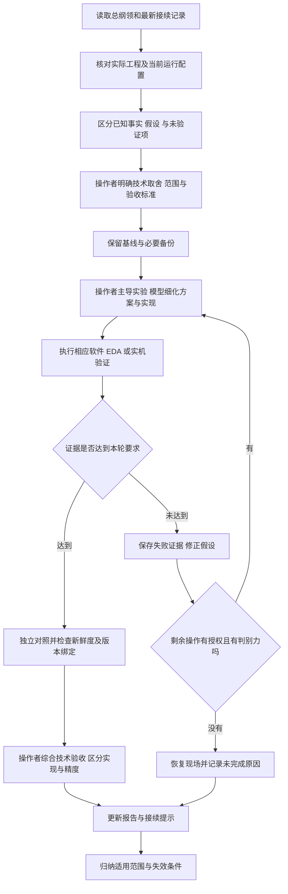
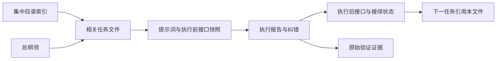

# 工程协作工作流

**适用范围：** 多轮软硬件开发、实验排查、算法迁移和现场恢复。输入为本轮目标、有效工程、接口和相关证据；输出为可审查的实现与验证、恢复状态及下一轮可继承结论。

**使用方法：** 按下文执行模式核对目标与事实，选择[提示词工程流](prompt_workflows.md)中的技能，以[案例模板](case_templates.md)记录同一任务的执行与纠错。操作者承担复杂技术取舍和实物判断，模型在已明确的范围内分析、实现及验证。

**效果来源与失效条件：** 来源为[历史协作案例](../report/llm_collaboration.md#4-典型交互与自我纠错轨迹)中的有界构建、实验核验和状态修订。接口或证据不可确认时，先限定结论与可执行范围；该流程本身不证明新项目的功能或精度。

## 1 协作执行模式

协作以操作者的工程目标、物理事实和技术取舍为牵引，由模型分析并调用工程工具，再以工具和实机反馈约束结论。下图结合历史做法与下文的操作者技术职责整理为可复用流程，属于职责与控制流说明，不表示已经开发独立的多智能体平台。



## 2 上下文管理

每轮优先提供“总纲领＋当前任务＋最近相关报告＋实际入口＋当前约束”，再读取必要日志与代码，避免把旧参数、旧 PID、旧目录和旧失败当成当前事实。提示词与报告在集中目录中按日期时间排列，使用模块标签和接口名称检索；不按模型、执行阶段或代码模块另拆散任务正文。接续提示保留以下六项：

1. 当前唯一主线及本轮完成标准。
2. 有效工程、服务入口和最近已验证版本。
3. 现场物理状态，以及哪些信息仅来自操作者说明。
4. 已知失败、反例和禁止重用的旧参考。
5. 可执行下一步及其通过标准。
6. 结束时需要恢复的状态与证据保存位置。

遇到总纲领尚未覆盖的晚期专项修复，应保留总纲领的总体架构，采用专项记录对具体状态的修订，并在接续中明确差异。不要为了得到单一简洁结论而抹去差异。

**历史信息按需回调。** 从索引找到相关模块，再读最新已执行记录的最终结论、接口变化和证据；发生冲突时回溯它所引用的前置任务。任务开始前必须核对实际入口，不能仅因历史文件写得详细就把旧接口当当前接口。总纲领保存长期架构与已接受决策，任务文件保存过程与失败细节，目录索引用于快速定位，三者各保留自己的职责。



## 3 工具编排与有界重试

| 任务类型 | 优先证据 | 修改与验证顺序 | 应停止扩展的情形 |
| --- | --- | --- | --- |
| BD/IP 构建异常 | 当前 XPR/BD、实际失败命令、缺失输出 | 确认入口与生成关系，再生成必要输出，最后综合 | 工具未到达设计验证阶段；本轮次数或范围已经用尽 |
| 时序与 CDC | routed 路径、时钟关系、RTL 协议、例外覆盖 | 先分析成因，定点修改，再完整实现及定向检查 | 没有协议依据而只能放宽约束；需要另一个独立任务 |
| 射频初始化 | 原理图、错误返回、寄存器和控制读回 | 先加可验证诊断，再最小配置修复及新采样 | 硬件状态未确认，继续访问可能无时钟的接口 |
| 空口测向 | 原始 IQ、独立帧、FCS、TSF、阶段哈希 | 先来源与新鲜度，再相位，再参考，再角度与交汇 | 参考失配、跨批门槛失败、异帧或无法区分同次发射 |
| 算法迁移 | 修改前代码与真实黄金样本 | 提取共享算法、本机回放、新实收复算、正式入口计数 | 输出不一致或发生未经说明的旧路径回退 |
| 配置及前端 | 生效配置、操作恢复日志、HTTP/DOM/状态机 | 明确动作语义，故障分支验证，再实际状态核对 | 恢复未确认或仅有界面文字而后端状态不一致 |

重试应引入新的信息或修正已识别原因。重复同一输入、反复归零、删除失败样本、放宽质量门槛，都不构成有效纠错。

## 4 输出契约与回退

模型的完成报告应包含实际修改、运行过的命令或工具、关键返回、原始证据、未通过项和下一步。若未执行某一环节，应使用“未执行”或“待验证”，而不靠预期结果补齐记录。

关键技术事项另记“操作者判断与依据”，说明架构、实验、参考策略或验收口径的取舍，以及模型提供了哪些分析和验证支持。操作者实际完成的精密测量、复杂调试和方案设计应按事实记入；暂未执行的技术任务列入接续，不提前记为完成。

涉及板端部署时，先保存版本及配置摘要，安装后核验真实生效；涉及参考采集时，成功、失败或取消均应恢复实际频点和上下文。无法确认恢复时，应暂停相关自动任务并保存操作状态，避免继续产出看似正常的结果。

## 5 同文件的任务生命周期

任务文件以创建时间命名，之后不因执行结束或结果变化而改名。正文中的创建、执行开始、执行结束和最后更新分别记录，避免把文件名时间误认为所有步骤的发生时间。

| 状态 | 使用条件 | 接续动作 |
| --- | --- | --- |
| 待执行 | 提示词已写好，尚未开始工具或实机操作 | 核对接口与范围后执行；不报告成果 |
| 进行中 | 已开始操作，尚未形成最终交付 | 在原文件追加进展，保留开始前状态 |
| 待外部条件 | 需要设备连接、物理摆位或其他明确条件 | 写明条件、当前现场和可继续的独立工作 |
| 已完成 | 本轮约定目标和验证均已完成 | 更新索引；完成范围仅限本轮目标 |
| 部分完成 | 有可交付结果，但仍有本轮目标未完成 | 分开列出通过、未通过和未执行项 |
| 失败 | 已执行，但核心通过条件未达到 | 保存失败证据、恢复现场，提出有判别力的下一步 |
| 已取消 | 操作者取消任务或明确改变主线 | 保留已执行事实和恢复状态，不改写为成功 |

任务状态与技术验收状态分开。例如“诊断任务已完成”可以同时对应“相位稳定性未通过”；“代码修改完成”不能自动对应“实机部署已验证”。开始新的独立目标时创建新文件并引用前置任务；同一目标的执行结果、补充说明和纠错留在原文件，追加各自时间。

## 6 可视化与检索方式

集中目录的 `README.md` 采用任务表作为导航，至少记录文件、模块标签、状态、关键结论和接续关系。GitHub 可直接按文件名查看时间顺序，进入单个文件后用目录跳到提示词、接口、执行报告和纠错。Mermaid 用于展示实际数据流或状态转换，不用图形替代验证证据。

以下命令只检索记录，不执行硬件或修改服务。`prompts` 是示例目录，使用现有工作区时替换为 `提示词`：

```sh
rg --files prompts -g '*.md'
rg -n 'DOA|IQ|reference|接口变化|后续接续' prompts -g '*.md'
rg -n 'api/doa/observations|directionContext' prompts -g '*.md'
```

查到关键词后，还要读其日期、执行状态和配置条件。关键词命中和文件更新时间都不能单独证明接口当前有效。

## 7 操作者主导的复杂技术任务

以下分工适用于后续任务设计与技能复用。操作者可根据专业能力与实际仪器条件分配具体工作；记录中应区分职责安排、已完成操作和待验证事项，不将安排本身写成历史成果。

| 技术任务 | 操作者承担的关键工作 | 模型提供的技术支持 | 应保留的交付依据 |
| --- | --- | --- | --- |
| 系统架构与软硬件协同 | 确定处理链目标、实时性与资源约束，权衡 FPGA、板端 CPU 和 PC 的功能划分，判断复杂方案是否符合实际硬件条件 | 梳理数据流、接口和依赖，比较候选划分，计算负载并实现所选方案 | 架构取舍说明、执行位置、接口契约与性能验证范围 |
| 射频链路与精密硬件核验 | 核对参考时钟、射频接线和接触质量；在具备仪器条件时组织频率、幅度及链路一致性测量，区分实测、寄存器读回与推算 | 追踪驱动和寄存器含义，形成测量步骤，分析波形、读回和误差来源 | 测量条件、仪器或读回来源、原始记录和未测量项 |
| 阵列几何与相位标定 | 确定阵距、基线、阵列朝向及参考源几何；组织精确摆位，选择标定与冻结参考策略，判断参考适用条件 | 推导相位与角度关系，计算几何期望、偏置和误差敏感性，实现参考管理与拒绝逻辑 | 几何来源、参考采集条件、训练与留出划分、适用性及独立位置结果 |
| 实验设计与误差分析 | 主导控制变量、共同输入或换线对照、独立移位等判别实验；识别接触、重启、多径与配置变化的混杂，确定统计及精度评价口径 | 提出可区分假设，生成采样脚本，执行统计与可视化，列出反例和未排除因素 | 冻结条件、操作时间、样本及失败记录、误差定义和因果判断依据 |
| 时序与 CDC 技术审查 | 审视时钟关系、跨域数据稳定协议与板级约束依据，判断修复是否保持真实硬件语义及签核边界 | 提取最差路径、解释 RTL 和工具报告，实施限定修改并运行综合实现 | 协议说明、约束依据、前后报告、例外覆盖与剩余风险 |
| 复杂故障归因与路线调整 | 综合物理观察、测量和软件证据，决定继续排查的主线；区分可确认根因、候选解释和需要补测的问题 | 维护假设及证据对照，定位代码、复算数据、比较方案成本，及时修订受反证影响的判断 | 根因证据、排除范围、路线调整理由及下一项有判别力的实验 |
| 最终技术验收与能力界定 | 确定本轮通过标准，综合独立验证判断功能、重复性及精度是否分别达标，界定对外宣称的能力范围 | 汇总验证矩阵、检查版本与统计口径一致性，提供可复算结果和未通过项 | 验收依据、操作者技术判断、未完成项和结论边界 |

例如，“固定参考是否可以沿用”涉及物理布站、接收链相位与使用目标，应由操作者作工程取舍；模型负责提供当前配置、相位对照、历史适用条件和拒绝原因。操作者明确固定复用策略后，记录仍须保留“是否重新核验精度”的独立状态，不能用技术决策代替测量结果。

模型在已经明确的范围和技术标准内继续实现、验证与归档。遇到只能由实物测量确认的条件、关键方案分歧或超出当前证据的精度判断时，记录需要操作者承担的具体技术任务和所需依据，保持任务可接续。

历史工作归属见[协作记录](../report/llm_collaboration.md)。新任务从[提示词工程流](prompt_workflows.md)选择技能，使用[同文件模板](case_templates.md)归档，以[校验脚本](validation_scripts.md)检查适用输入。
